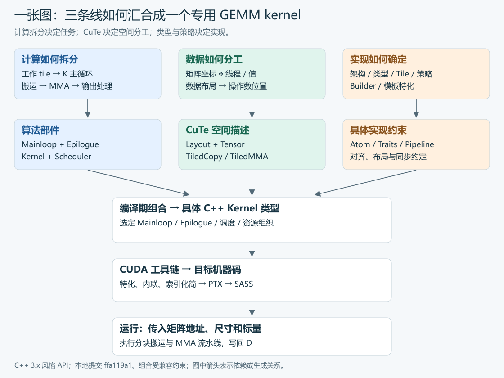
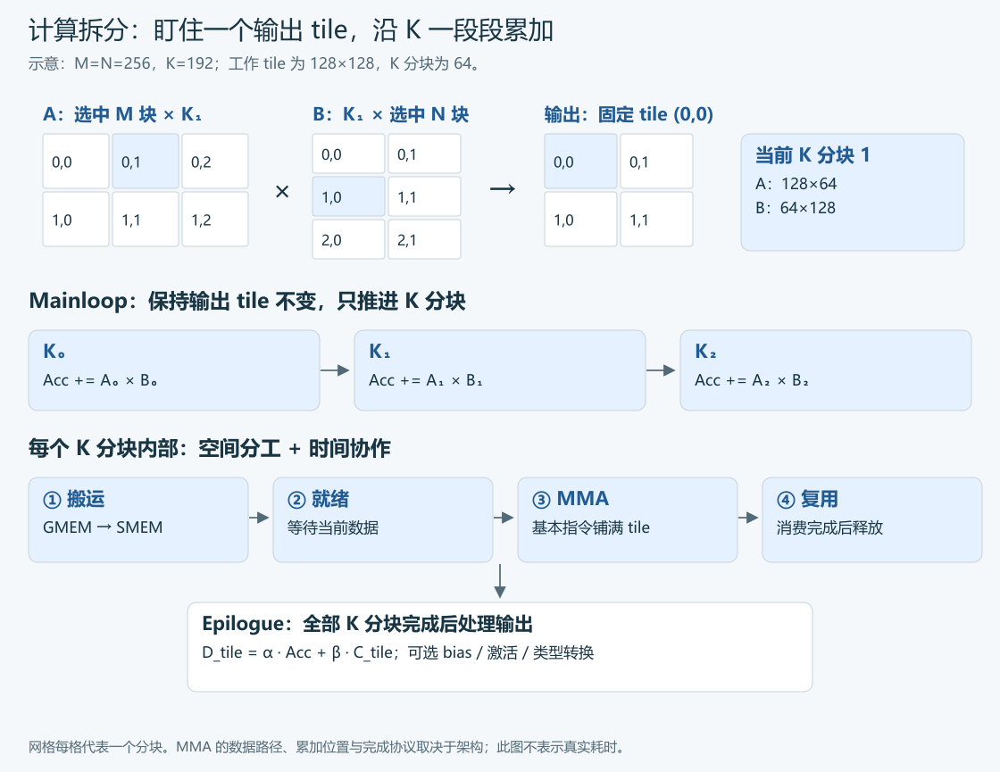
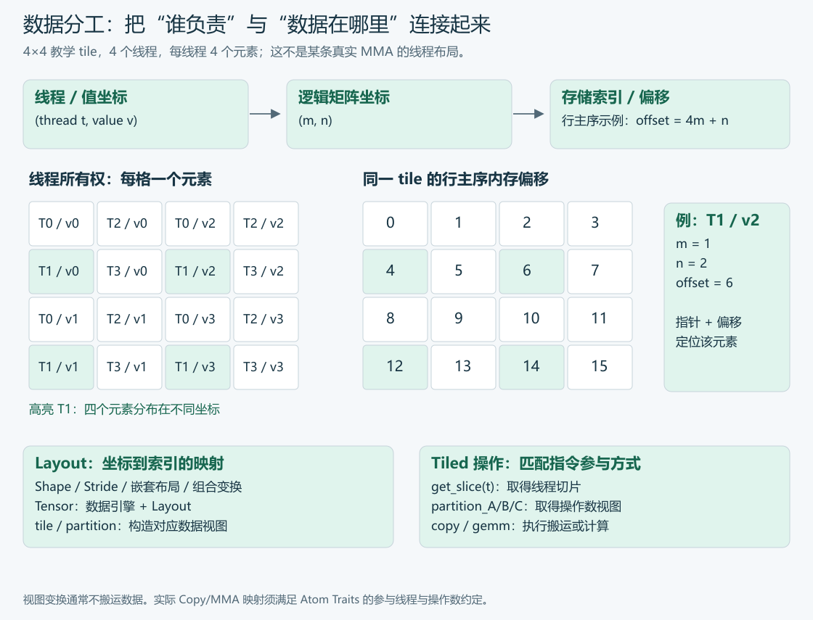
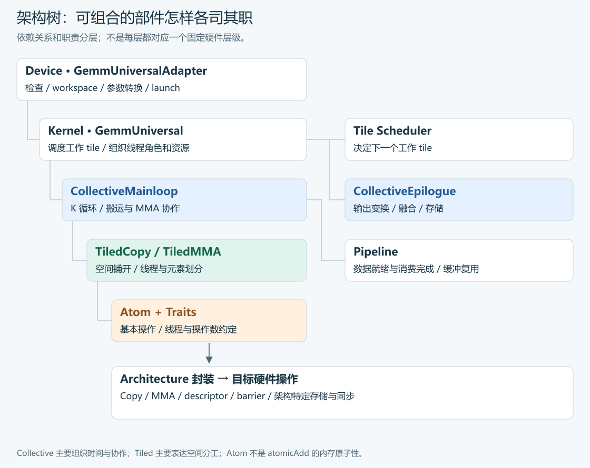
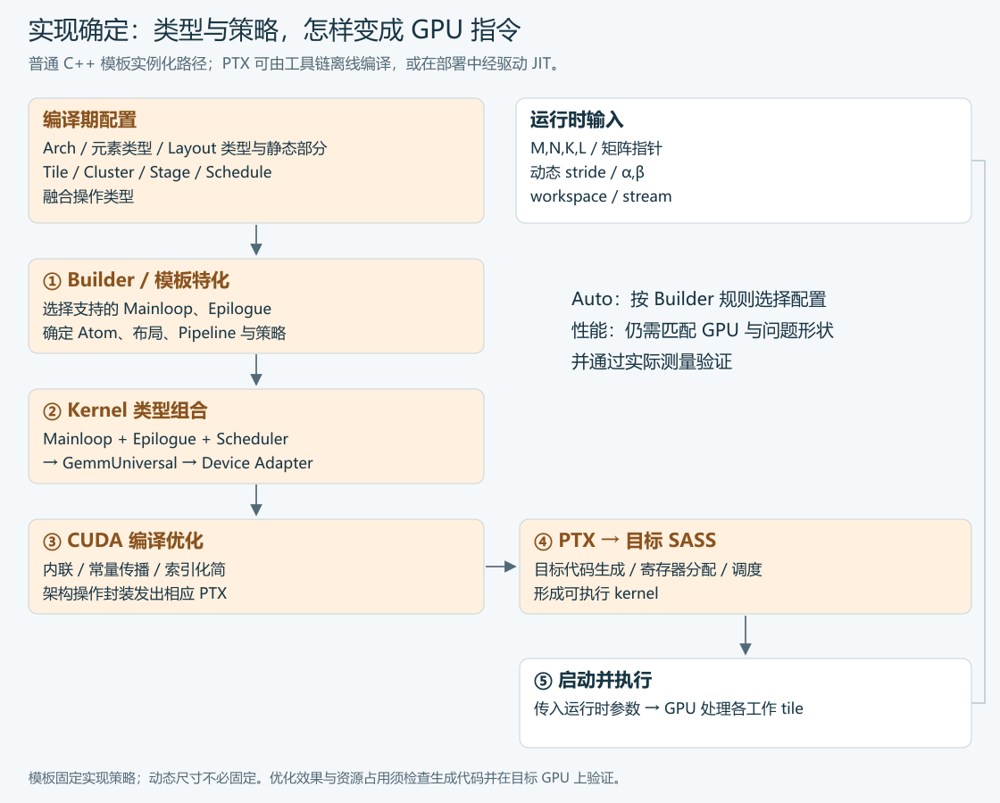
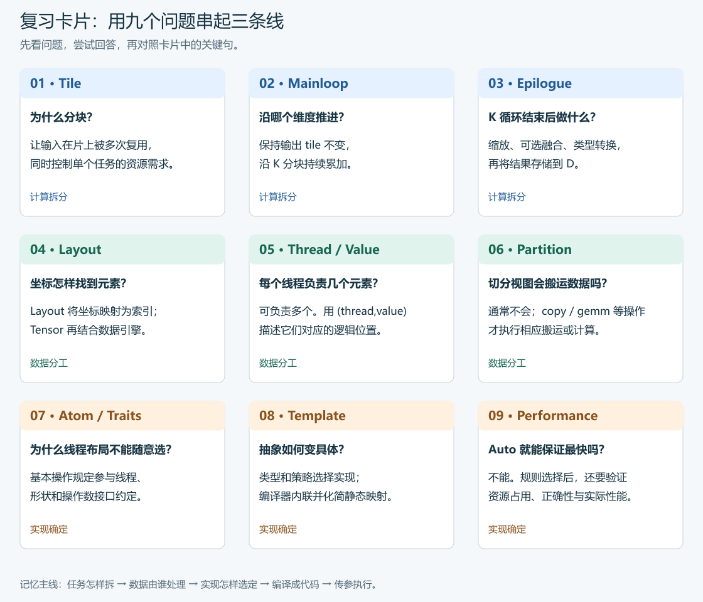

# CUTLASS 三条线图解

主线：把 GEMM 设计知识编码成可组合部件，用 CuTe 表达空间映射，再通过编译期类型与策略选择，生成适合目标 GPU 的专用 kernel。

分析基准：本地 CUTLASS 提交 `ffa119a1`；C++ 3.x 风格 GEMM API。示意图不构成目标 GPU 的性能测试。

## 建议阅读顺序

1. **三线总览**：看清算法部件、空间映射和实现约束如何汇合。
2. **计算拆分**：固定一个输出 tile，沿 K 分块累加；每个分块涉及搬运、等待、MMA 和缓冲复用。
3. **CuTe 映射**：先回答“哪个线程负责哪个逻辑元素”，再回答“这个元素位于哪里”。
4. **架构树**：将计算、映射、同步、调度分别放到对应部件中。
5. **编译流程**：区分编译期配置与运行时参数，追踪类型组合到目标代码的过程。
6. **复习卡片**：尝试先回答问题，再看关键句。

## 贯穿例子

M=N=256，K=192；工作 tile 为 128×128，K 分块为 64。输出有 4 个逻辑工作 tile；每个 tile 经过 3 个 K 分块的累加。逻辑工作 tile 与实际线程块的关系取决于调度策略。

CuTe 教学映射使用 4×4 tile，4 个线程，每线程 4 个元素：

- `m = t % 2 + 2 * (v % 2)`
- `n = floor(t / 2) + 2 * floor(v / 2)`
- 行主序：`offset = 4*m + n`
- 列主序：`offset = m + 4*n`

例如 T1/v2 对应 (1,2)，行主序偏移 6，列主序偏移 9。这个映射是教学例子，不是某条 MMA 指令的实际线程布局。真实 MMA / Copy 映射由目标操作的 Traits 和操作数约束决定。

## 对应源码入口

- 组合：`examples/49_hopper_gemm_with_collective_builder/49_collective_builder.cu:307`，Epilogue/Mainloop → GemmUniversal → GemmUniversalAdapter。
- tile 与线程切片：`examples/cute/tutorial/sgemm_sm80.cu:103`、`:118`、`:156`。
- Layout：`include/cute/layout.hpp:167`。
- 主机参数检查与启动：`include/cutlass/gemm/device/gemm_universal_adapter.h:232` 起。

源码根目录：`E:/000wsp/01repo/08sutlass/cutlass`。

## 理解边界

- tile / partition 通常构造视图；copy / gemm 等操作才执行相应搬运或计算。
- Collective 主要组织协作和时间；Tiled 主要描述空间分工，两者需要共同满足架构约束。
- 图中缓冲生命周期是逻辑示意，异步 MMA 的完成和释放依具体实现协议而定。
- Builder 的 Auto 按规则选择配置，不等于通过实测自动搜索最快 kernel。
- 静态类型和布局信息支持内联与索引化简；实际优化效果应检查生成代码并在目标 GPU 上验证。

## 文件与检查

每张图提供 PNG 和可编辑 SVG。六张静态图已渲染并逐张检查；交互映射的两种布局共 32 种组合已检查覆盖、选择与状态恢复。交互图的浏览器实际排版未验证。
