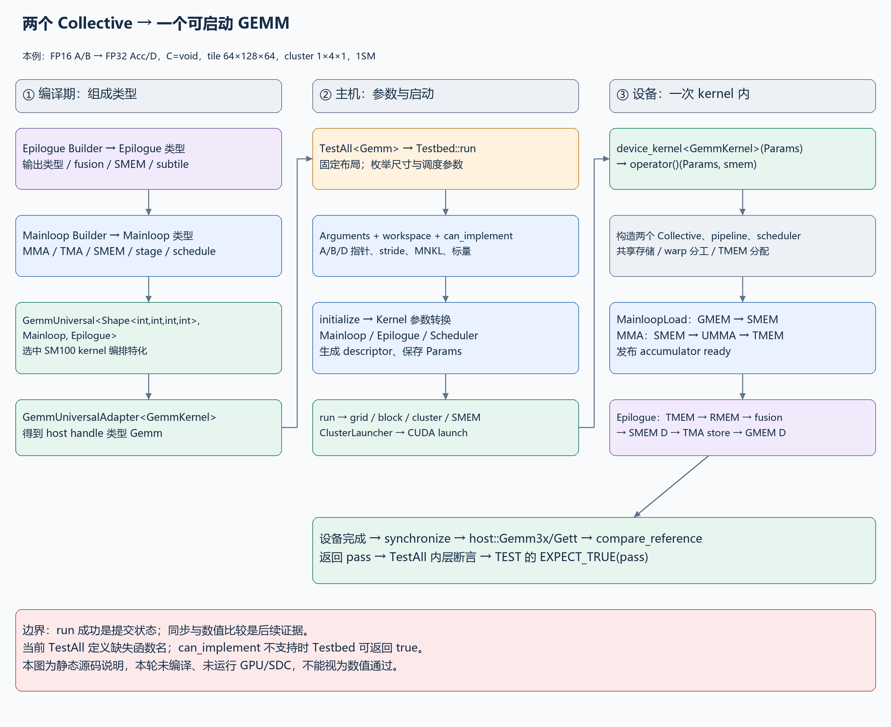
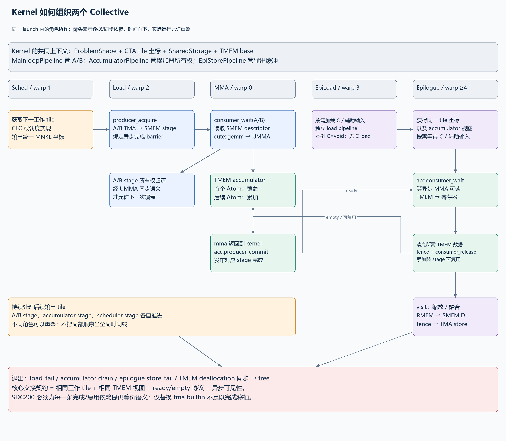
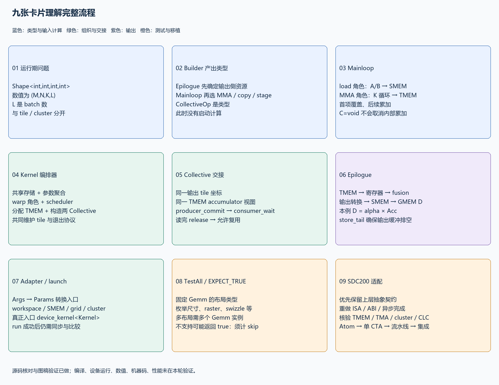
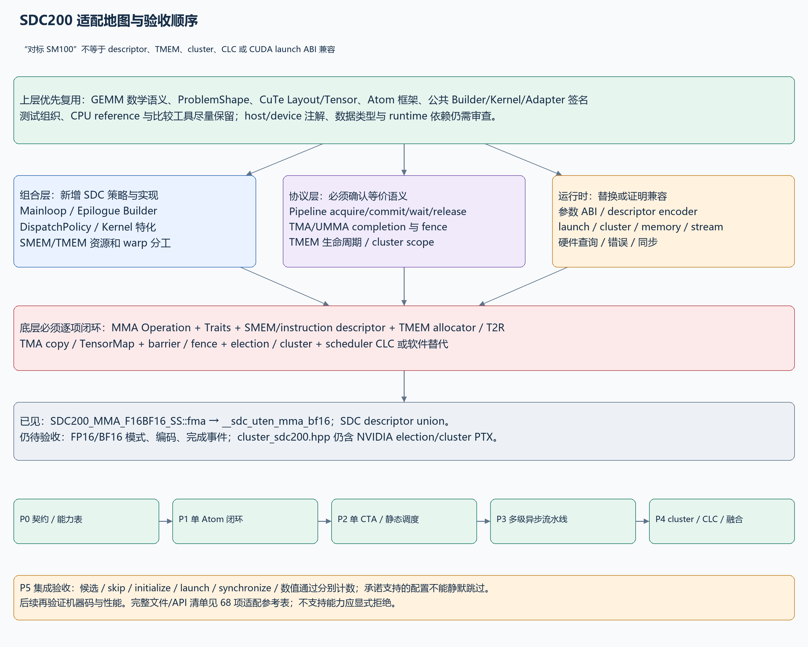

# 从两个 Collective 到可启动 GEMM：SM100 源码链与 SDC200 适配指南

本文对应本项目此前的 FP16 输入、FP32 累加/输出、`ElementC=void`、tile `64×128×64`、cluster `1×4×1`、1SM 测例。先解释这条具体路径，再区分可泛化的接口与 SM100 专用实现。完整逐项适配清单见 [SDC200 适配参考表](sdc200-adaptation.md)，可筛选版本见 [CSV 表格](sdc200-adaptation.csv)。

## 0. 最重要的结论与证据边界

`GemmUniversal<Shape<int,int,int,int>, Mainloop, Epilogue>` 通过模板特化选中 kernel 编排器。编排器把两个 Collective 的类型、参数、共享存储、线程角色、调度器和同步协议组合起来。真正的 `__global__` 入口是 `device_kernel<GemmKernel>`，入口内部构造 kernel functor 并调用其 `operator()(Params, smem)`。

两个 Collective 运行于同一次 kernel launch。Mainloop 内部又分搬运和 MMA 角色；Epilogue 内部又分可选 C/辅助输入搬运和输出处理角色。它们通过 **相同的输出 tile 坐标、同一份 TMEM 累加器视图、AccumulatorPipeline 的生产/消费协议** 衔接，整个过程不是一次 host 端 `Mainloop(); Epilogue();` 的串行调用。

四个 `int` 是运行时 `(M,N,K,L)` 的类型，L 是批次数。主循环 tile、CTA cluster、Atom shape、epilogue subtile 均为另一层概念。

**需要修正原问题的一点：单次 `TestAll<Gemm>()` 不枚举 A/B/C/D 的 RowMajor/ColumnMajor 类型组合。** 这些布局已在 `Gemm` 的类型中固定。不同布局组合由其他 `TEST`/类型实例化覆盖；本次 `TestAll` 枚举问题规模、raster order、swizzle 和 splits 等候选参数。

### 本次证据来源

- SM100 源码：`D:/000_SDC/001TASK/02_Research/cutlass`，HEAD `f94ec46f4f63f96003d6cfdf2014731e7672c281`。工作树存在既有修改，本文行号以本轮读取的工作树为准。
- SDC200 参考树：`D:/lvz/sdc/cutlass`，HEAD `dc45f979ae336a235da1676b311f35efeb30149a`。仅抽查相关包装和描述符，未做全仓适配完成度审计。
- SDC builtin 声明：`D:/lvz/sdc/sccnext-main/sccnext-main/clang/lib/Headers/sdc/sdc_builtins.h`。
- 当前 `gemm_testbed_3x.hpp:3828` 为 `bool  (...)`，缺失 `TestAll` 名称。已对照同一 HEAD 提交内容确认原函数为 `bool TestAll(...)`。以下描述其函数体的预期语义，**不表示当前工作树可直接编译**，本次没有修复或改动源代码。
- 本机 PATH 未发现 `nvcc`、`nvidia-smi`。本次只完成源码核对、文档、图稿与文件检查，没有 CUDA/SDC 编译、GPU/模拟器运行、数值通过、机器码或性能验证。
- NVIDIA 官方资料也将 kernel 层定义为两个 Collective 的组合，再由 host adapter 包装；具体 SM100 实现和行号仍以本地版本为准：[CUTLASS 3.x GEMM API](https://docs.nvidia.com/cutlass/4.5.0/media/docs/cpp/gemm_api_3x.html)、[内核 API 与兼容性](https://docs.nvidia.com/cutlass/latest/media/docs/cpp/cutlass_3x_backwards_compatibility.html)。

## 1. 先看完整调用链



[PNG](01-end-to-end.png) · [可编辑 Draw.io](01-end-to-end.drawio)

```text
编译期
  CollectiveBuilder(epilogue) → CollectiveEpilogue
  CollectiveBuilder(mainloop, epilogue SMEM carveout) → CollectiveMainloop
  GemmUniversal<ProblemShape, Mainloop, Epilogue> → GemmKernel 类型
  GemmUniversalAdapter<GemmKernel> → Gemm 类型

主机运行期，每个候选问题
  TEST → TestAll<Gemm> → Testbed3x::run → TestbedImpl::run
    → sufficient / initialize inputs
    → Gemm::Arguments{mode, problem_shape, mainloop, epilogue, hw_info, scheduler}
    → get_workspace_size → allocate → can_implement
    → adapter.initialize
         → kernel.initialize_workspace
         → kernel.to_underlying_arguments
             → mainloop.to_underlying_arguments：A/B tensor + TMA descriptor
             → epilogue.to_underlying_arguments：fusion + C/D TMA descriptor
             → scheduler.to_underlying_arguments
         → 保存 Params，必要时设置 dynamic SMEM 属性
    → adapter.run → grid/block/cluster/SMEM
         → ClusterLauncher::launch_with_fallback_cluster（本例非 1×1×1）
         → cudaLaunchKernelExC

设备运行期，一次 kernel launch 内
  device_kernel<GemmKernel>(Params) → GemmKernel::operator()(Params, smem)
    → 建立共享存储、Collective 对象、pipeline、scheduler、TMEM
    → scheduler 持续给出 tile
    → load warp：GMEM A/B → SMEM 多级缓冲
    → MMA warp：SMEM descriptor → UMMA → FP32 TMEM
    → accumulator pipeline：通知完成、等待消费、允许复用
    → epilogue warp：TMEM → registers → fusion → SMEM D → TMA store → GMEM D
    → tail/drain → 安全释放 TMEM → kernel 完成

主机验证
  synchronize → host::Gemm3x/Gett reference → compare_reference
  → bool pass → 内层 EXPECT_TRUE → 外层 EXPECT_TRUE(pass)
```

`run()` 的成功通常说明 launch 阶段没有报告错误，不意味着异步设备计算已完成。Testbed 后续同步并比较结果，才覆盖设备运行和数值检查。

## 2. 编译期：为什么只写三个模板实参就能组成 kernel

### 2.1 Builder 产出的是类型

```cpp
using Epilogue = typename EpilogueBuilder</*输出、融合、tile、架构*/>::CollectiveOp;
using Mainloop = typename MainloopBuilder<
    /*输入、MMA、tile、cluster、stage、schedule*/>::CollectiveOp;

using GemmKernel = cutlass::gemm::kernel::GemmUniversal<
    cute::Shape<int,int,int,int>, Mainloop, Epilogue>;
using Gemm = cutlass::gemm::device::GemmUniversalAdapter<GemmKernel>;
```

这些 `using` 不申请 GPU 内存，也不执行 GEMM。Builder 根据元素类型、布局、对齐、tile、cluster 和 schedule 选择 `CollectiveMma`/`CollectiveEpilogue` 的模板特化。通常先构建 Epilogue，是因为 Mainloop 的 `StageCountAutoCarveout<sizeof(Epilogue::SharedStorage)>` 需要预留输出侧存储，随后还要扣除 kernel 同步、调度等空间。

本例 epilogue Auto 选 1SM TMA 路径；Mainloop Auto 选 TMA + UMMA warp-specialized 路径。Mainloop builder 将 `TiledMma`、A/B 全局拷贝、SMEM layout、stage 数和 `DispatchPolicy` 打包成 `CollectiveMma` 类型。

### 2.2 `GemmUniversal` 不是把任意两个类粘在一起

声明在 `include/cutlass/gemm/kernel/gemm_universal_decl.h`，聚合头 `gemm_universal.hpp` include 多个架构实现。本例的实现是 `sm100_gemm_tma_warpspecialized.hpp:61` 起的偏特化，其使能条件检查 `Mainloop::DispatchPolicy::Schedule` 是否属于 `KernelTmaWarpSpecializedSm100` 或其 block-scaled 类别。

它从 Mainloop 提取 `TileShape/TiledMma/ArchTag/StrideA/B/ElementAccumulator/ClusterShape/Arguments/Params`，从 Epilogue 提取 `EpilogueTile/ElementC/D/StrideC/D/Arguments/Params/ThreadCount`。随后建立 scheduler 和多个 pipeline。接口必须在这些类型和同步约定上匹配；仅仅同名、继承了某个类或输出类型相同都不够。

省略的第四个模板参数默认 `void`。`tile_scheduler.hpp:207` 的 SM100 selector 把它映射到 `PersistentTileSchedulerSm100<ClusterShape, SchedulerPipelineStageCount>`。该实现包含硬件 CLC 工作获取，不能把它当作完全与架构无关的整数循环。

### 2.3 形状与地址，必须分四层

| 层 | 本例 | 谁决定 | 用途 |
|---|---|---|---|
| 完整问题 | `(M,N,K,L)` | 运行时 `Arguments.problem_shape` | 整个 GEMM 和 batch 范围 |
| Mainloop tile | `64×128×64` | 编译期 Builder | 输出 tile 和 K 分块 |
| CTA cluster | `1×4×1` | 编译期配置，本例静态 | 4 个 CTA 沿 N 协同，完整覆盖 64×512 |
| MMA Atom | `64×128×16`，对应本例 FP16 | MMA Traits | 每个完整 K tile 有 4 个 K=16 子操作 |
| Epilogue subtile | Auto 推导 | epilogue Builder | 分片加载 TMEM、融合并存回 D |

CuTe 的 A 视图为 `(M,K,L)`，B 为 `(N,K,L)`；B 的坐标顺序不同于数学记法 `B[K,N]`，不代表物理执行转置。batch 是通过 stride 的第 3 分量访问同一问题的第 l 批。

## 3. Kernel 在结构上怎样容纳两个 Collective

### 3.1 两套参数嵌入一套 kernel 参数

本例实现 `sm100_gemm_tma_warpspecialized.hpp:215` 的 host 接口为：

```cpp
struct Arguments {
  GemmUniversalMode mode;
  ProblemShape problem_shape;
  MainloopArguments mainloop;
  EpilogueArguments epilogue;
  KernelHardwareInfo hw_info;
  TileSchedulerArguments scheduler;
};
struct Params {
  GemmUniversalMode mode;
  ProblemShape problem_shape;
  MainloopParams mainloop;
  EpilogueParams epilogue;
  TileSchedulerParams scheduler;
  KernelHardwareInfo hw_info;
};
```

`Arguments` 面向调用者：A/B/C/D 指针、stride、alpha/beta 和调度选项。`Params` 面向设备：包含下层已经转换的 TMA/融合/调度描述。两者不是简单的同结构拷贝，也不是把整块矩阵复制进参数。

Kernel 的 `to_underlying_arguments` 是总调度者，分别调用两个 Collective 和 scheduler 的转换函数。Adapter 调用这个总转换并保存 `params_`；描述符的实际构建知识属于各个 Collective/CuTe 后端。

### 3.2 参数转换的具体数据流

Mainloop 的 `Arguments` 包括 `ptr_A, dA, ptr_B, dB` 及运行时数据类型字段。转换函数读取 `(M,N,K,L)`，构造 `tensor_a(M,K,L,dA)` 与 `tensor_b(N,K,L,dB)`，结合 SMEM layout、TiledMma 与 cluster layout 调用 `make_tma_atom_A_sm100` 和 `make_tma_atom_B_sm100`。该实现还构造 fallback 描述符字段；静态 cluster 的构造函数选择常规路径。

Epilogue 的转换函数建立 C/D 视图及 TMA 参数，并调用 `FusionCallbacks::to_underlying_arguments`。C=void 时实际 C 数据路径禁用，D 描述符仍然必要。alpha/beta 的数值与是否读取 C，受 fusion 配置及其参数共同控制。

注意三种“描述符”不同：

| 描述符 | 构建/使用位置 | 描述内容 | 移植注意 |
|---|---|---|---|
| TMA TensorMap | host 参数转换 → device copy | 全局 tensor、尺寸、stride、tile、swizzle 等 | NVIDIA 路径可调用 `cuTensorMapEncodeTiled`；SDC 需确认等价 ABI |
| UMMA SMEM descriptor | device MMA fragment/Traits | 共享内存地址、步长和 swizzle 等 | 不是 A/B 的数据，也不是普通 64 位指针 |
| UMMA instruction descriptor | Traits → fma | 输入/累加类型、M/N、major、取负等指令模式 | 不能默认与 SDC 位编码一致 |

### 3.3 共享存储不是中间矩阵

`SharedStorage` 在 kernel 文件 `:182` 处组合：

- `pipelines.mainloop`：A/B 缓冲的空/满及异步事务同步。
- `pipelines.epi_load`：可选 C/辅助输入搬运同步。
- `load_order`、`clc`、`clc_throttle`：搬运顺序和工作分发。
- `pipelines.accumulator`：Mainloop 与 Epilogue 的 TMEM 所有权交接。
- `tmem_dealloc`：退出和释放 TMEM 的参与者同步。
- `clc_response[]`、`tmem_base_ptr`：调度响应和 TMEM 基地址。
- `tensors.epilogue`、`tensors.mainloop`：输出侧 SMEM 暂存和 A/B 多级 SMEM 缓冲。

该版本的 `TensorStorage` 包含并列成员，不能泛称为两个 Collective 的 SMEM 总是 `union` 复用。TMEM 累加器本体也不在上述 SMEM 数组中，SMEM 只保存其地址及同步元数据。

## 4. 设备端：两个 Collective 的详细协作



[PNG](02-collective-handoff.png) · [可编辑 Draw.io](02-collective-handoff.drawio)

### 4.1 线程分工

本例 kernel 的 `WarpCategory` 为：warp 0=MMA，warp 1=Sched，warp 2=MainloopLoad，warp 3=EpilogueLoad，warp 4 及之后=Epilogue。线程数公式为 `4×NumThreadsPerWarp + Epilogue::ThreadCount`；图上角色表示源码分工，不把总线程数硬编码为所有配置都相同。

| 角色 | 主要工作 | 所属层 |
|---|---|---|
| Sched | 获取/广播下一工作 tile，维护 CLC pipeline | Kernel + TileScheduler |
| MainloopLoad | 取 A/B tile，经 TMA 放入 SMEM stage | CollectiveMainloop |
| MMA | 等待 A/B ready、发射 MMA、写 TMEM、发布 accumulator ready | CollectiveMainloop + kernel 的交接代码 |
| EpilogueLoad | 按需搬 C/辅助输入 | CollectiveEpilogue；本例默认 C=void，无需 C load |
| Epilogue | 等待累加完成、TMEM→寄存器、融合、存 D、释放 accumulator stage | CollectiveEpilogue |

角色划分不代表所有代码每个线程都执行。warp/lane predicate 控制具体发射者；一个 warp 的角色也不等于硬件操作必须由 32 个 lane 各自发射一遍。

### 4.2 初始化：先建立共同“坐标系”和同步对象

1. 读取 warp、lane、cluster rank，映射角色；将动态 SMEM 缓冲解释为 `SharedStorage`。
2. 以各自 `Params` 构造 `CollectiveMainloop` 和 `CollectiveEpilogue`，它们引用同一次 launch 的参数/存储。
3. 初始化 MainloopPipeline、EpiLoadPipeline、EpiStorePipeline、AccumulatorPipeline、CLC pipeline 和 barrier，并执行所需同步，使初始化结果对参与者可见。
4. `load_init` 根据 tensor 与 cluster 分区生成后续 TMA copy 使用的视图和 multicast mask。
5. `init_tmem_tensors` 构造累加器 tensor 的布局；MMA 角色申请 TMEM，写入 `tmem_base_ptr`，通过分配结果 barrier 通知输出角色；双方 `set_tmem_offsets` 令自己的 tensor 视图指向同一物理 TMEM。
6. 每个角色从 scheduler 对应的工作流得到相同逻辑输出 tile，并分别维护本角色的 pipeline state。不是所有 warp 去抢同一个任务后自行猜测归属。

### 4.3 A/B 搬运协议：防止提前读取和提前覆盖

`CollectiveMainloop::load`，`sm100_mma_warpspecialized.hpp:589`：

```text
producer_acquire(write_state)          等这个 stage 可写
producer_get_barrier(write_state)      获得异步事务完成对象
write_stage = write_state.index()
copy(TMA_A.with(barrier, maskA), A_tile, smemA[write_stage])
copy(TMA_B.with(barrier, maskB), B_tile, smemB[write_stage])
推进 K iterator / state
```

MMA 侧 `consumer_wait(read_state)` 等待 TMA 数据完成，再从相同 stage 的 SMEM descriptor 读取。完成对应异步 MMA 读取所要求的同步后，通过 `consumer_release` 路径允许生产者复用 SMEM。底层 SM100 pipeline 含 UMMA arrival/commit 语义，不能将 release 机械替换为一个普通计数器写。

本例 cluster 沿 N 有 4 个 CTA，它们需要同一 M/K 范围的 A、不同 N 范围的 B，Builder 因而可为 A 选择 multicast。multicast 是 cluster 搬运能力，不改变 1SM MMA 的协作粒度。

### 4.4 MMA 与 TMEM：两个 Collective 的真正交接点

`CollectiveMainloop::mma`，同文件 `:652` 起：

1. `accumulator_pipeline.producer_acquire(acc_state)`，等待有一个可写的 TMEM accumulator stage。
2. 对新输出 tile 设置 `tiled_mma.accumulate_ = ScaleOut::Zero`。
3. 对每个 K tile 等 `mainloop_pipeline.consumer_wait`，选择 `read_stage`。
4. 逐个 Atom K 子块执行 `cute::gemm(tiled_mma, descA_fragment, descB_fragment, accumulators)`；首次之后设置 `ScaleOut::One`，继续累计部分和。
5. 释放对应 A/B stage，推进到下一个 K tile。
6. 返回 kernel 后，kernel 在 `sm100_gemm_tma_warpspecialized.hpp:770` 调用 `accumulator_pipeline.producer_commit(acc_state)`，将异步 UMMA 完成纳入消费者可等待的协议，然后推进 accumulator state。

`slice_accumulator(tmem_storage, acc_stage)` 传递的是指定 stage 的 tensor 视图，并没有 host 拷贝或先写一份中间 GMEM 矩阵。Epilogue 取得同一地址/布局的 accumulator 视图。

实际 MMA 调用链：

```text
CollectiveMainloop::mma
  → cute::gemm
  → MMA_Atom::call
  → MMA_Traits<SM100_MMA_F16BF16_SS>::mma_unpack（ADL hidden friend）
      desc_a = A[0]; desc_b = B[0]
      tmem_c = raw_pointer_cast(D.data())
      idesc = make_runtime_instr_desc(traits.idesc_)
  → SM100_MMA_F16BF16_SS::fma
  → elect_one_sync 的发射 lane
  → tcgen05.mma.cta_group::1.kind::f16
```

`ElementC=void` 是禁用 epilogue 的全局源矩阵 C；`scaleC`/`accumulate_` 则控制 MMA 是否保留旧 TMEM 部分和。它们含义不同，因此 C=void 仍有跨 K 的累加。

### 4.5 Epilogue 消费协议与输出

Kernel 在 `:897` 取得 accumulator 视图，调用 `scheduler.fixup`；本例默认 scheduler 不切分 K，不需要 split-K 归并。随后把 accumulator、对应 pipeline/state、完整 problem shape、tile 坐标和 epilogue SMEM 一并交给 `CollectiveEpilogue::store`。

Epilogue 在相关 subtile 上执行：

```text
acc_pipeline.consumer_wait             等 UMMA 的结果可读
copy(tiled_t2r, tmem_accumulator, rAcc)  TMEM → 寄存器
fence_view_async_tmem_load              需要释放时确保相关 TMEM 读取满足完成约束
acc_pipeline.consumer_release          该 stage 不再需要时，交还给 MMA
cst_callbacks.visit(...)               alpha/beta/融合计算
NumericArrayConverter                  转成输出 SMEM 元素类型
copy(tiled_r2s, rD, sD[stage])          寄存器 → SMEM
fence_view_async_shared + synchronize  让 TMA 看见所有输出写入
copy(tma_store_d, sD, gD)               SMEM → GMEM D
store pipeline commit/acquire/tail     等待、复用与排空输出缓冲
```

TMEM stage 的 release 可以发生在相关累加器数据已读取到寄存器之后，不必等待整个 D 都写完；具体时机由 subtile、`do_acc_release` 和 overlapping 配置决定。不能把 epilogue 的每个 subtile 都画成“释放整个 TMEM”。

默认计算为 `D = alpha*Acc + beta*C`；本例 C=void，等效 `D = alpha*Acc`。输出 FP32，默认 alpha=1，因而验证的是每批 FP16 A/B 形成的 FP32 GEMM 结果。

### 4.6 持续调度与退出

load、MMA、epilogue 可以处理不同流水阶段，持续推进多个输出 tile。Mainloop 的 A/B stage 数、TMEM accumulator stage 数、scheduler pipeline stage 数是不同的容量，不应统称一个 `Stages`。

退出时需要 load_tail、accumulator 的完成/消费同步、epilogue load/store tail、TMEM 分配许可释放和最终 free。TMEM 的释放必须满足全部参与者不再访问；单看 `mma()` 返回不能证明可立即 free。

## 5. Adapter 怎样把这个 C++ 类型启动到设备

`GemmUniversalAdapter` 是有状态的 host handle，3.x 特化在 `gemm_universal_adapter.h:123`。它保存 `Params params_`，提供稳定接口，但内部 launch 仍有 NVIDIA 架构与运行时依赖。

| 调用 | 实际负责的事 | 不应混淆 |
|---|---|---|
| `get_workspace_size(args)` | 查询 kernel/epilogue/scheduler 的额外全局工作区 | 不是 `SharedStorageSize`，也不含调用者的全部 A/B/D 内存 |
| `can_implement(args)` | 聚合 mode、Collective、scheduler、cluster 等约束 | 不执行 kernel，不保证后续申请/launch 成功 |
| `initialize(args, workspace, stream)` | 初始化 workspace，调用 kernel 参数转换，保存 params_，必要时设置动态 SMEM 属性 | 3.x 这个实现不会自动替调用者执行一遍 `can_implement` |
| `update(args, workspace)` | 重新转换/更新参数，检查所需 workspace | 不能概括为已重新完成所有 workspace 初始化/函数属性配置 |
| `run(stream)` | 使用保存的 params_ 计算 launch 配置并提交 kernel | 是异步提交，尚未 host reference 比较 |
| `run(args, workspace, stream)` / 对应 `operator()` | 先 initialize 再 run | 仍需要调用者提供正确生命周期的内存和参数 |

本例 `ArchTag=Sm100`、静态 cluster 大小为 4，所以普通 host launch 路径进入 `ClusterLauncher::launch_with_fallback_cluster`，内部用 `cudaLaunchKernelExC`。静态 `1×1×1`、动态 cluster、其他架构、启用 `CudaHostAdapter` 等配置会走不同分支，不能把这一条路径推广为所有 Gemm 的唯一 launch。

`device_kernel.h:118` 中的入口收到 `Params`，声明动态共享内存 `smem[]`，构造 `Operator op`，调用 `op(params, smem)`。所以严格来说 `GemmUniversal` 提供 kernel 的实现类型/编排，而可被 runtime launch 的函数实例是这个入口包装。

## 6. TestAll、Testbed、EXPECT_TRUE 的完整语义

### 6.1 一次 TestAll 的覆盖范围

布局来自已经固定的 `Gemm`；函数体读取其 alignment、TileK 和 Stages 来生成尺寸。本例：

| 测试轴 | 候选/行为 |
|---|---|
| M | `{8, 488}` |
| N | `{8, 496}` |
| K | `{8, 64*(S+1)-8}`，S=`GemmKernel::DispatchPolicy::Stages` |
| L | 常规循环为 1；最后另测 `(264,264,168,3)` |
| raster order | AlongM、AlongN，属于 tile 遍历次序，不是矩阵存储布局 |
| max swizzle size | 1、4，属于 scheduler tile 重排参数，不是 SMEM swizzle 位编码 |
| decomposition | 默认 heuristic；显式 StreamK scheduler 才增加其他模式 |
| splits | 内层依据 K tile 数生成多个候选；默认 persistent scheduler 的 args 只接收 raster/swizzle，不实际启用 split-K |
| alpha / beta / equality | 默认 1 / 0（C=void）/ RELATIVE |

举例：**若编译结果 S=8**，较大 K=568，K tile 数为 9。小 K 的 splits 列表为 `{1,1,2}`，保留重复项；大 K 为 `{1,2,3,9,10}`。候选 Testbed 调用数是 `2*2*2*2*(3+5)+1 = 129`。这是条件化的静态枚举推导，不能据此声称本轮真的启动了 129 次 kernel。因为 `can_implement` 跳过、异常或提前失败都会改变实际执行数，且 S 在本轮未重新编译求值。

### 6.2 每次 Testbed 做什么

1. `sufficient()` 查询设备和每 block 可用动态 SMEM，本版本不满足会返回 false。
2. HostCollectiveMainloop 初始化 A/B，HostCollectiveEpilogue 初始化 C/D 与标量/参考数据，并完成所需 host/device 数据传输。
3. 构建 kernel `Arguments`：`mode=kGemm`、problem size、mainloop args、epilogue args、hw_info、scheduler args。注意本测试 rank=4 的 batch 也使用此实现接受的 `kGemm` 路径，不能把所有 L>1 都机械解释成测试设置了 `kBatched`。
4. 查询并申请 workspace；检查 `can_implement`；初始化 adapter；提交 run。
5. `cudaDeviceSynchronize()` 捕捉异步错误。
6. `verify()` 调用 `cutlass::reference::host::Gemm3x`，底层 `Gett` 做主机参考计算，再比较 D。
7. 内部断言给出具体问题信息；失败返回 false，`TestAll` 退出；最外层 `EXPECT_TRUE(pass)` 将返回结果登记到 GoogleTest。

### 6.3 通过标志的实际限制，移植时尤其重要

当前 `gemm_testbed_3x.hpp:2991–2996` 在 `can_implement` 不成功时打印“不支持”并返回 **true**。因此 TestAll 的 true 可能包含未执行候选。`EXPECT_TRUE(pass)` 断言的是函数返回值，不是“所有理论配置都完成了计算”。GoogleTest 还会保留其他内层断言失败，不能只看最终 bool。

当前 Testbed 在 initialize 错误时仅打印，随后仍调用 run，并覆盖 `status`。移植验证版建议明确区分初始化失败、launch 失败、设备失败、数值失败、能力跳过，而不是依赖这个宽松控制流。

SDC200 测试报告应至少记录：候选数、明确不支持数、initialize 成功数、launch 成功数、同步成功数、数值比较成功数，以及每个 `(M,N,K,L,layout,scheduler)`。强制验收的目标配置如果跳过，应判为未完成，不能算数值通过。本次只给出建议，没有修改测试框架。

## 7. 卡片：每层该记住什么



[PNG](03-concept-cards.png) · [可编辑 Draw.io](03-concept-cards.drawio)

| 卡片 | 一句话 | 最容易混淆的边界 |
|---|---|---|
| ProblemShape | int×4 表示运行期 M/N/K/L | 不决定 tile、warp 或 cluster |
| Builders | 选择并生成两个 Collective 类型 | `CollectiveOp` 是类型，不是一次运算结果 |
| Mainloop | 搬 A/B 并跨 K 累加到 TMEM | 一份 Mainloop 内部已经有 load/MMA 两个角色 |
| Kernel | 组织角色、存储、同步和任务坐标 | 不只是两个函数调用的顺序 |
| Handoff | accumulator view + pipeline 交接 | ready 信号必须对应异步完成与可见性 |
| Epilogue | 读累加器、融合、转换并存 D | C=void 不影响 MMA 内部累加 |
| Adapter | host 参数转换入口与 launch handle | launch 成功不等于数值通过 |
| TestAll | 对固定 Gemm 枚举尺寸/调度 | 多布局需要多个类型/测试实例 |
| SDC200 | 保留抽象契约，重建硬件语义 | 替换 MMA builtin 只覆盖链条中的一环 |

## 8. SDC200：适配边界与现有代码的真实状态



[PNG](04-sdc200-porting.png) · [可编辑 Draw.io](04-sdc200-porting.drawio)

“对标 SM100”是能力目标，不自动说明 SDC200 与 NVIDIA 的 ABI、warp、cluster、TMEM、descriptor、CLC、异步内存模型和 CUDA runtime 相同。建议保留 `GemmUniversal/CollectiveBuilder/GemmUniversalAdapter` 的用户接口形状，新增 SDC 架构策略和后端，按已验证能力启用配置。

### 8.1 当前能确认的 SDC 参考实现

现有 `D:/lvz/sdc/cutlass/include/cute/arch/mma_sdc200_umma.hpp:72` 定义 `SDC200_MMA_F16BF16_SS`，`fma` 在 `:108` 接受两个 64 位 descriptor、32 位 TMEM 地址、scaleC 和组合 instruction descriptor；在 `:117` 调用：

```cpp
__sdc_uten_mma_bf16(tmem_c, desc_a, desc_b,
                    uint32_t(idescE >> 32), scaleC);
```

实际 compiler header `sdc_builtins.h:897` 声明：

```cpp
void __sdc_uten_mma_bf16(uint32_t dTmem, uint64_t aDesc,
                        uint64_t bDesc, uint32_t iDesc,
                        uint32_t inputD);
```

这证明包装层和 builtin 形参形式已有对应；**不证明 FP16 模式、descriptor 字段、K 粒度、完成事件或数值已正确**。builtin 名含 bf16，包装类型支持 F16/BF16，实际类型选择是否由 iDesc 控制，需要以 SDC 编译器/ISA 契约和 FP16/BF16 两套运行测试确认。

`mma_sdc200_desc.hpp:109` 具有 `SmemDescriptor` union，属于 ABI 敏感数据结构。不能因为字段名/位宽和 SM100 相似就将它作为兼容结论；需要 golden bit-pattern、合法/非法布局与硬件读取验证。

`cluster_sdc200.hpp:180` 的 `elect_one_sync` 仍含 `elect.sync`；该文件还有 `barrier.cluster`、`mapa.shared::cluster` 和 NVIDIA 宏条件。可能依赖编译器兼容支持，也可能尚未替换，当前不能认定已原生适配。include 应放在全局命名空间，并通过后端选择避免同一翻译单元重复定义 `cute::elect_one_sync` 或出现 `cute::cute`。

### 8.2 两条适配路径与边界

| 能力条件 | 可以保留什么 | 必须改变什么 |
|---|---|---|
| SDC 有等价异步 TMA、可寻址 TMEM、完成 barrier、cluster 语义 | 可考虑保留类似 Mainloop/Epilogue 的协议和 kernel 分工 | 每个 descriptor、builtin、completion、runtime launch 和资源常量仍需验证/替换 |
| 有 MMA/TMEM，但无 CLC | 可保留 GEMM 数据链和部分流水线 | 使用静态 tile 调度或软件队列；scheduler 实现、selector 与 kernel 调度角色需适配 |
| 无 cluster 或 multicast | 单 CTA GEMM 抽象仍可保留 | 先用 cluster=1；A/B 独立搬运；删除/重做 cluster 同步与发射约束 |
| 无等价 TMA | Tensor/布局与分块思想可保留 | 用协作 load 或其他 DMA，重做 Mainloop load、同步和输出 store 路径 |
| MMA 结果在寄存器、无等价 TMEM | GEMM 上层类型接口与计算语义可保留 | 重建 accumulator fragment/Traits、Kernel handoff、Epilogue T2R，不能照搬 TMEM kernel |
| CUDA runtime/launch ABI 不兼容 | Adapter 用户方法命名可保留 | runtime shim 或新 launcher、设备属性/分配/拷贝/同步/错误、host descriptor encoder |

`CudaHostAdapter` 可作为 host launch 扩展点之一，但不能修复 device 内联 PTX、descriptor ABI 或同步语义。现 Adapter 使用 `kMinComputeCapability >= 90`、`==100/101/103/120` 等分支；即便给新架构设置“200”也不等于自动走正确 launch。应该用明确后端/能力选择替代借用 NVIDIA 编号来蒙混分发。

### 8.3 完整参考表与阅读顺序

[打开完整适配表](sdc200-adaptation.md)。表格覆盖：构建与宏、架构标签、类型/布局、Builder、dispatch、两个 Collective、kernel、scheduler、pipeline、barrier、TMA host/device、UMMA Traits/descriptor/Operation、TMEM、epilogue fusion、adapter/runtime、测试/reference、诊断和扩展范围。每行列出实际文件/API、可复用部分、需要适配部分、候选 SDC 落点及验收标准。

表中“建议新增”是设计建议，不是声称文件已经存在；“条件复用”是接口/算法在满足契约后可复用，不表示整个文件可以原封不动照搬。完整性针对本例 dense FP16/FP32 1SM 链以及扩展接入边界，不代表未经硬件规格就能列尽整个 CUTLASS 仓库的所有架构功能。

### 8.4 建议的落地顺序与验收门槛

1. **P0：固化契约。** 确认 lane/warp、MMA 形状、TMEM 地址/容量、三类 descriptor、异步完成、barrier scope、cluster 和 runtime；为每项标记已支持/可兼容/需模拟/不支持。
2. **P1：底层闭环。** descriptor 编码 → 单次 MMA → TMEM 读回 → 与主机参考比较；覆盖 overwrite/accumulate、FP16/BF16、合法 tile 与拒绝条件。先证明一个 Atom，不直接跳入复杂 persistent kernel。
3. **P2：单 CTA。** 固定支持的 tile，cluster=1，静态调度，最简单搬运和无融合 epilogue，跑多 K tile、尾块和 batch。该阶段改变了调度/搬运策略，不能将通过结果视为原 SM100 路径全兼容。
4. **P3：异步流水线。** 增加多级 load/MMA/accumulator/store；用大 K、多 tile、重复运行压力验证 stage 所有权、phase wrap、尾部 drain 与可见性。
5. **P4：高级功能。** 依次启用 TMA、multicast/cluster、CLC 或软件替代、融合、Stream-K/2SM 等。每项独立列覆盖矩阵，能力不支持要明确拒绝。
6. **P5：集成验收。** 修复测试入口问题后接入 SDC unit target，强制记录实际执行与 skip；数值通过后再查机器码和性能。优化前记录 baseline，不能用编译成功替代正确性或吞吐达标。

## 9. 关键源码导航

下列行号来自本次工作树，后续修改会漂移；完整快照与 SHA-256 见 `source-evidence.json`，关键片段见 `source-excerpts.txt`。

| 目的 | 文件 | 位置 |
|---|---|---|
| 本例 Builder/Kernel/Adapter/TestAll | `test/unit/gemm/device/sm100_tensorop_gemm/f16_f16_void_f32.cu` | 197、215、234、244、253 |
| GemmUniversal 声明/聚合入口 | `include/cutlass/gemm/kernel/gemm_universal_decl.h`；`gemm_universal.hpp` | 模板声明；SM100 include |
| 偏特化与类型拼装 | `include/cutlass/gemm/kernel/sm100_gemm_tma_warpspecialized.hpp` | 61–179 |
| shared storage / args / params | 同上 | 182、215、225 |
| 参数转换/检查/workspace/grid | 同上 | 257、301、339、384 |
| warp 角色与对象建立 | 同上 | 234、405、435 |
| TMEM、MMA、发布完成 | 同上 | 727、762、770 |
| Epilogue 调用 | 同上 | 897、911 |
| Adapter initialize/run | `include/cutlass/gemm/device/gemm_universal_adapter.h` | 313、375、509 |
| 真正 global 入口 | `include/cutlass/device_kernel.h` | 118 |
| 扩展 launch | `include/cutlass/cluster_launch.hpp` | 294 |
| Mainloop host 转换/load/mma | `include/cutlass/gemm/collective/sm100_mma_warpspecialized.hpp` | 355、589、652 |
| MMA Traits→fma | `include/cute/atom/mma_traits_sm100.hpp` | 284、323 |
| MMA 指令落点 | `include/cute/arch/mma_sm100_umma.hpp` | 86、111 |
| Epilogue T2R/fusion/store | `include/cutlass/epilogue/collective/sm100_epilogue_tma_warpspecialized.hpp` | 574、866、882、895、922、771 |
| Testbed 执行与 skip 语义 | `test/unit/gemm/device/gemm_testbed_3x.hpp` | 2877、2991、3014、3023、3032、3047 |
| TestAll 当前损坏与枚举 | 同上 | 3828、3840、3853、3878、3966 |
| CPU 参考 | `tools/util/include/cutlass/util/reference/host/gett.hpp` | 491、837 |

## 10. 交付与验证

- 本文、独立适配表、UTF-8 CSV 表、4 组 PNG/Draw.io、离线阅读页均保存在当前项目 `deliverables/gemm-universal-sdc200/`。
- 所有 PNG 和 `.drawio` 来自同一节点/连线/文本/坐标数据；Draw.io 中节点、箭头和文字可单独编辑，没有用整张位图替代结构。字体字形、抗锯齿和箭头尖端在不同渲染器中可能略有区别。
- 检查范围：文件存在、源链接与锚点、UTF-8、Draw.io XML、节点/连线、PNG 尺寸、主要布局和文字视觉检查；详细结果见 `validation.json`。
- 本轮没有改动 CUTLASS/SDC 源文件，也没有进行编译或设备数值测试。
- 本轮问答完整记录保存在 `qa-history/2026-10-20/`。本地持久保存已完成；未配置并验证跨电脑同步渠道，本轮跨电脑同步未完成。
