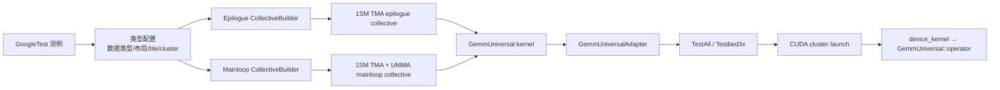
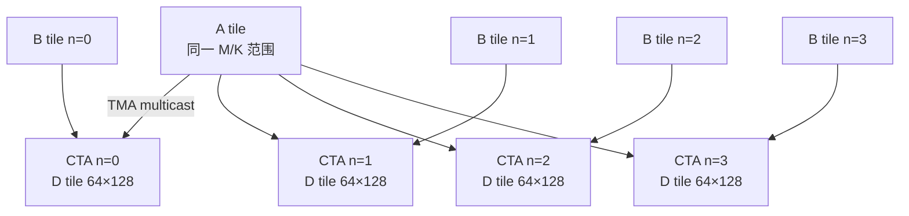
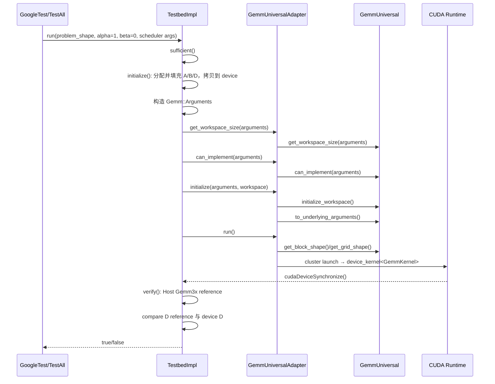
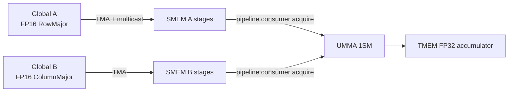
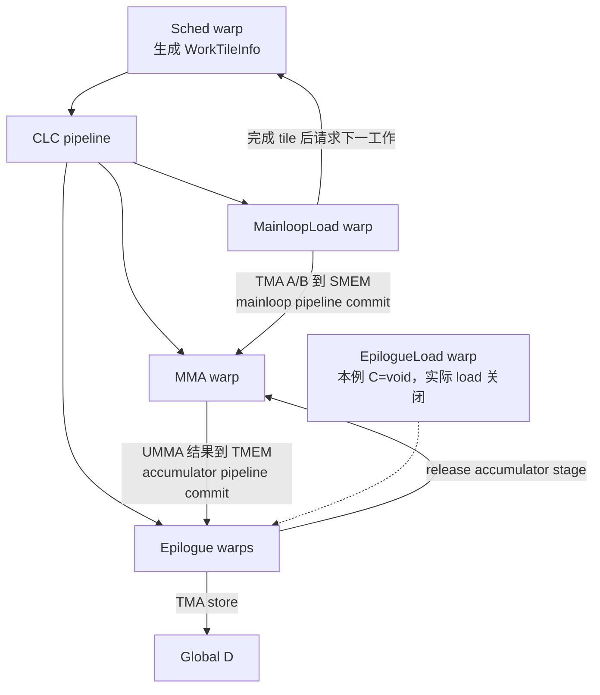

# CUTLASS SM100 `f16t × f16n → f32t` 1SM GEMM 测例调用链指南

> 分析对象：`TEST(SM100Only_Device_Gemm_f16t_f16n_void_f32t_tensor_op_f32, 64x128x64_1x4x1_1sm)`  
> 本地源码：`E:\000wsp\01repo\08sutlass\cutlass`  
> 源码版本：`v4.8.0dev-1-gffa119a1`，提交 `ffa119a1255d`  
> 目标读者：第一次阅读 CUTLASS 3.x、希望从一个真实 SM100 GEMM 测例进入 Device API 与 kernel 内部实现的开发者

## 1. 先建立整体心智模型

这个测例并不是直接写 CUDA kernel。它先用类型系统描述 GEMM，再由 Builder 在编译期选择 SM100 的具体实现，最后通过 Device API 启动一个 warp-specialized persistent kernel。

本例计算：

\[
D_{M\times N}=\alpha\,(A_{M\times K}B_{K\times N})
\]

因为 `ElementC = void`，没有源矩阵 C，默认 `beta = 0`，所以没有 `beta*C` 项。输入 A、B 为 FP16，MMA 累加和 epilogue 计算为 FP32，输出 D 为 FP32。



在 CUTLASS 3.x 中，可以把各层理解为：

| 层次 | 本例中的对象 | 作用 |
|---|---|---|
| 测试层 | `TestAll<Gemm>()`、`Testbed3x` | 构造多组问题、初始化数据、运行并与 Host reference 比较 |
| Device API | `GemmUniversalAdapter<GemmKernel>` | 把用户参数转换为 kernel 参数，管理 workspace、launch 配置与 CUDA 启动 |
| Kernel 层 | `GemmUniversal<...>` | 把 CTA 内 warp 分成调度、加载、MMA、epilogue 等角色，组织持久化流水线 |
| Collective 层 | `CollectiveMma`、`CollectiveEpilogue` | 实现一个 CTA tile 的 mainloop 数据搬运/MMA，以及输出融合与写回 |
| CuTe/Atom 层 | `TiledMma`、TMA atom、pipeline/barrier | 描述 tensor layout、切分、硬件指令 atom 和同步协议 |
| 硬件层 | TMA、UMMA、SMEM、TMEM、cluster | 执行异步加载、矩阵乘累加、跨 CTA multicast 和输出存储 |

## 2. 测例配置逐项展开

入口位于：

- `test/unit/gemm/device/sm100_tensorop_gemm/f16_f16_void_f32.cu:133`：测例开始。
- 同文件 `:135-151`：A/B/C/D 类型、布局和对齐。
- 同文件 `:159-162`：tile 与 cluster shape。
- 同文件 `:168-179`：epilogue builder。
- 同文件 `:185-197`：mainloop builder、kernel 和 Device adapter。
- 同文件 `:199`：进入 `TestAll<Gemm>()`。

配置的准确含义如下：

| 配置 | 值 | 含义 |
|---|---:|---|
| `ElementA` | `cutlass::half_t` | A 元素为 FP16 |
| `GmemLayoutA` | `RowMajor` | A 逻辑形状为 M×K，K 连续；测例名中的 `f16t` 表示 CUTLASS GEMM 记号中的转置布局 |
| `AlignA` | 8 elements | 每次按 8 个 half，即 128 bit 对齐 |
| `ElementB` | `cutlass::half_t` | B 元素为 FP16 |
| `GmemLayoutB` | `ColumnMajor` | B 逻辑形状为 K×N，K 连续；测例名中的 `f16n` |
| `AlignB` | 8 elements | 128 bit 对齐 |
| `ElementC` | `void` | 不读取 C；epilogue source load 路径在本例关闭 |
| `ElementD` | `float` | 输出为 FP32 |
| `GmemLayoutD` | `RowMajor` | D 的 N 维连续；测例名中的 `f32t` |
| Accumulator/Compute | `float` | UMMA 累加及 epilogue 标量运算均用 FP32 |
| `MmaTileShape_MNK` | `64×128×64` | 每个调度 tile 覆盖 M=64、N=128、K 分块=64 |
| `ClusterShape_MNK` | `1×4×1` | 4 个 CTA 沿 N 方向组成 cluster |
| Scheduler | 默认 | 未传第四模板参数，使用 `PersistentScheduler` 默认标签 |

### 2.1 为什么它确实是 1SM kernel

测例名称末尾的 `1sm` 只是便于人阅读；真正的选择由 Builder 完成。

Mainloop 的 `KernelScheduleAuto` 进入 `sm100_umma_builder.inl:169` 的 SM100 dense GEMM specialization。该 specialization 在 `:209` 判断 2SM：显式 2SM，或未显式指定且 cluster M 为偶数。这里 cluster M=1，因此 `is_2sm=false`。随后 `sm100_common.inl:444` 的 `sm100_make_trivial_tiled_mma()` 在 Auto 分支中也因为 cluster M 不是 2 的倍数而选择 1SM UMMA。

Epilogue 的 `EpilogueScheduleAuto` 进入 `sm100_builder.inl:1677`。`is_2sm()` 位于 `:1699`，要求 cluster M 为偶数，并且普通 TensorOp 的 tile M 为 128 或 256。本例 `clusterM=1`、`tileM=64`，因此 `:1715` 得到 `TmaWarpSpecialized1Sm`。

编译期结果可以概括为：

```text
KernelScheduleAuto
└─ clusterM=1，tileM=64
   └─ 1SM UMMA TiledMma
      └─ MainloopSm100TmaUmmaWarpSpecialized<...>
         └─ CollectiveMma<...>

EpilogueScheduleAuto
└─ clusterM=1，tileM=64
   └─ TmaWarpSpecialized1Sm
      └─ SM100 TMA warp-specialized CollectiveEpilogue
```

### 2.2 `1×4×1` cluster 的实际意义

一个 cluster 有 4 个 CTA，M 坐标相同、N 坐标不同。每个 CTA 计算自己的 `64×128` 输出 tile。它们使用同一段 A 的 M/K 范围，而 B 的 N 范围不同，所以 cluster 形状有利于 A 的 TMA multicast：一次 A tile 搬运可服务多个沿 N 排列的 CTA。B 通常按各 CTA 的 N tile 分别加载。



注意：cluster 是执行与数据共享的组织单位，不等于 2SM MMA。本例仍是每个 CTA 使用 1SM UMMA atom。

## 3. Host 侧完整调用链

### 3.1 从 GoogleTest 到测试组合生成

```text
TEST(..., 64x128x64_1x4x1_1sm)                         f16_f16_void_f32.cu:133
└─ 类型别名构造 CollectiveEpilogue / CollectiveMainloop
   └─ GemmKernel = kernel::GemmUniversal<...>
      └─ Gemm = device::GemmUniversalAdapter<GemmKernel> f16_f16_void_f32.cu:197
         └─ test::gemm::device::TestAll<Gemm>()           f16_f16_void_f32.cu:199
            └─ Testbed3x<Gemm>::run(...)                  gemm_testbed_3x.hpp:3145
               └─ TestbedImpl::run(...)                   gemm_testbed_3x.hpp:2895
```

`TestAll` 位于 `gemm_testbed_3x.hpp:3846`。它不是只运行一个固定尺寸，而是生成一组边界与非整 tile 问题，用来覆盖：

- M、N 的最小对齐尺寸和接近 512 的非规则尺寸；
- K 的最小对齐尺寸，以及跨越 mainloop pipeline stage 的尺寸；
- `AlongM` / `AlongN` 两种 raster order；
- 最大 swizzle 1 / 4；
- heuristic decomposition；
- 根据 K tile 数量生成 1、2、3、最大值以及超过最大值的 split 请求；
- 最后额外运行一个 batch=3 的 batched GEMM。

所以测试名中的 `64x128x64` 是 kernel tile，不是唯一的运行时矩阵尺寸。

### 3.2 Testbed 初始化、参数构造与启动

`TestbedImpl::run()` 的执行顺序：



关键代码位置：

1. `gemm_testbed_3x.hpp:2926` 调用测试数据初始化。A/B 使用 HostTensor，按设定分布填充并同步到 GPU。
2. `:2960-2991` 形成 `Gemm::Arguments`：mode、MNKL、mainloop 指针/stride、epilogue 参数、硬件信息和 scheduler 参数。
3. `:2998` 查询 workspace；`:3007` 检查实现约束。
4. `:3032` 初始化 adapter；`:3041` 启动 kernel；`:3050` 同步并捕获异步错误。
5. `:3065` 验证；实际 Host reference 在 `:2802` 调用 `cutlass::reference::host::Gemm3x`，随后比较输出。

### 3.3 Device Adapter 做了什么

`include/cutlass/gemm/device/gemm_universal_adapter.h` 是 Host API 与 kernel 类型之间的薄适配层：

| API | 位置 | 本例作用 |
|---|---:|---|
| `can_implement()` | `:231` | 转发到 kernel，检查 mode、TMA 对齐、epilogue 与 scheduler 约束 |
| `get_workspace_size()` | `:243` | 汇总 epilogue 与 persistent scheduler workspace |
| `initialize()` | `:313` | 初始化 workspace，把 `Arguments` 转成 `Params`，配置动态共享内存上限 |
| `run(Params&)` | `:395` | 获取 grid/block/smem，选择 SM100 cluster launch 路径 |
| `operator()(args, workspace)` | `:623` | initialize+run 的便捷入口；Testbed 本例分开调用 initialize 和无参 run |

由于 cluster 为 `1×4×1`，不是静态 `1×1×1`，Adapter 在 SM100 分支通过 `ClusterLauncher::launch_with_fallback_cluster()` 启动，向 CUDA 提供 preferred cluster 与 fallback cluster。普通 `<<<>>>` 语法不能完整表达这种 cluster launch 属性。

最终 CUDA 入口为：

```text
GemmUniversalAdapter::run
└─ ClusterLauncher::launch_with_fallback_cluster
   └─ cutlass::device_kernel<GemmKernel>              device_kernel.h:118
      ├─ extern __shared__ char smem[]
      └─ GemmKernel::operator()(params, smem)
```

## 4. Kernel 内调用链

真正的设备侧 kernel specialization 位于 `include/cutlass/gemm/kernel/sm100_gemm_tma_warpspecialized.hpp:67`，设备执行入口 `operator()` 位于 `:405`。

### 4.1 CTA 内 warp 角色

kernel 用 `warp_idx` 映射 `WarpCategory`（`:419`），角色声明在同文件 `:224` 附近：

```text
CTA
├─ warp 0: MMA
│  └─ 消费 SMEM 中 A/B，发出 UMMA，累加结果位于 TMEM
├─ warp 1: Sched
│  └─ cluster 第一个 CTA 负责 CLC/persistent tile 调度
├─ warp 2: MainloopLoad
│  └─ 发出 A/B 的 TMA gmem→smem 加载与 multicast
├─ warp 3: EpilogueLoad
│  └─ 需要 C/aux 时发出 epilogue TMA load；本例因 C=void 基本不参与
└─ warp 4...: Epilogue
   └─ 从 TMEM 取 accumulator，执行 alpha*x，写入 SMEM，再由 TMA 写 D
```

具体 epilogue warp 数由 `CollectiveEpilogue::ThreadCount` 编译期决定，所以不要假定永远只有一个 epilogue warp。`MaxThreadsPerBlock` 在 kernel 中由上述五类角色的线程数相加得到。

本例 `ElementC=void` 使 epilogue collective 的 `is_source_supported=false`（`sm100_epilogue_tma_warpspecialized.hpp:143`）。`is_producer_load_needed()` 在 `:448` 返回 false，因此 kernel `:453` 的 EpilogueLoad warp 不进入实际 load 分支。它仍存在于 CTA 的线程布局中，但不搬 C。

### 4.2 kernel 初始化阶段

`GemmUniversal::operator()` 首先完成：

1. 解包运行时 MNKL，取得 warp 类别与 cluster rank。
2. 把动态 SMEM 映射为 `SharedStorage`；其中包含 mainloop/epilogue tensor buffer、pipeline barrier、scheduler response 和 TMEM base pointer。
3. 构造 `CollectiveMainloop` 与 `CollectiveEpilogue`。
4. Sched warp 预取 A/B TMA descriptor（`:440-441`）；EpilogueLoad warp 预取 epilogue descriptor（`:443-444`）。
5. 初始化 mainloop、epilogue load/store、CLC、accumulator、load-order 等 pipeline。
6. `collective_mainloop.load_init()`（`:582`）建立 A/B 全局 tensor、TMA partition 和 SMEM tensor 的视图。
7. scheduler 产生第一个 `WorkTileInfo`，并计算 CTA 的 MNKL 坐标。
8. MMA warp 申请 TMEM，供 UMMA accumulator 使用。

这里的 pipeline 是生产者/消费者之间的硬件 barrier 协议，不是简单的 `__syncthreads()`。它允许 TMA、UMMA、epilogue 对不同 stage 并行推进。

### 4.3 MainloopLoad warp：Global → Shared

入口是 kernel `:617`，核心调用 `collective_mainloop.load()` 位于 `:640` 和 `:654`。第一次装载 prologue stages，随后装载剩余 K tiles。

collective 实现在 `include/cutlass/gemm/collective/sm100_mma_warpspecialized.hpp`：

- `load_init()`：`:499`，建立 `mA(M,K,L)`、`mB(N,K,L)` 与 TMA partition。
- `load()`：`:589`，逐个 K tile 获取空闲 pipeline stage。
- `:620-621`：通过 TMA atom 把 A/B 从 global memory 复制到当前 SMEM stage，并附带 multicast mask。
- `load_tail()`：`:633`，等待所有未完成 TMA stage 安全结束。

数据路径：



边界 tile 的越界处理由 TMA tensor/layout 和生成的 descriptor 表达，调用者不需要在测试文件中写逐元素 predicate。

### 4.4 Sched warp：Persistent tile 调度

入口是 kernel `:681`。只有 cluster 的第一个 CTA 参与 scheduler producer 工作（`:451`）。它通过 CLC pipeline 查询下一份工作；cluster 中其他 warp/CTA 消费同一份调度响应，从而保持 cluster 对同一逻辑工作单元的一致理解。

默认 scheduler 是 persistent scheduler：启动的 CTA 数量以设备资源为中心，而不是简单地为每个输出 tile 固定启动一个 CTA。一个驻留 CTA 完成当前 tile 后继续取下一个 `WorkTileInfo`，直到无有效工作。这也是 kernel 各角色主体使用 `do...while(work_tile_info.is_valid())` 的原因。

### 4.5 MMA warp：Shared → UMMA → Tensor Memory

入口是 kernel `:726`：

1. `TmemAllocator::allocate()` 申请 tensor memory 列并广播 base pointer。
2. `collective_mainloop.mma_init()` 创建 A/B 的 SMEM fragment 视图和 TMEM accumulator 视图。
3. 对每个 work tile，取得 K tile 数量和 accumulator pipeline stage。
4. `collective_mainloop.mma()`（kernel `:763`；collective `sm100_mma_warpspecialized.hpp:652`）循环消费 mainloop pipeline stage。
5. collective `:702` 的 `cute::gemm(tiled_mma, ...)` 映射为 SM100 UMMA 指令；输入在 SMEM，FP32 accumulator 在 TMEM。
6. 提交 accumulator pipeline，通知 epilogue 某个结果 stage 已就绪。
7. 全部工作结束后等待消费者释放 stage，并在 kernel `:804` 释放 TMEM。

`cute::gemm` 在这里并不是通用的软件三重循环。它操作 `TiledMma` atom；编译器展开后落到与数据类型、major mode 和 1SM shape 对应的 UMMA 指令序列。

### 4.6 Epilogue warp：Tensor Memory → Global D

本例无 C 输入，所以 EpilogueLoad 分支跳过。Epilogue warp 主体从 kernel `:869` 开始：

```text
等待 accumulator pipeline
└─ scheduler.fixup（需要 split-K/stream-K 时合并部分和）
   └─ collective_epilogue.store(...)
      ├─ TMEM → registers
      ├─ fusion callback：D = alpha * accumulator（beta*C 不存在）
      ├─ registers → SMEM D stage
      └─ TMA store：SMEM → global D
         └─ collective_epilogue.store_tail()              kernel:950
```

epilogue collective 位于 `include/cutlass/epilogue/collective/sm100_epilogue_tma_warpspecialized.hpp`：

- `store()`：`:574`（另有适配不同路径的 overload 位于 `:973`）。
- `tma_store_fn`：`:766`；其中 `:770-771` 由 elected warp 发出 D 的 TMA store。
- `store_tail()`：`:1271`，等待所有 store 安全完成。

输出的逻辑运算是默认 linear combination。`ElementCompute=float` 保证 alpha 乘法使用 FP32；结果以 `ElementD=float` 写入 RowMajor D。

### 4.7 五条并发分支如何协同



理解 kernel 的关键是：它不是“所有线程一起执行同一个 K 循环”。不同 warp 长时间执行不同函数，通过多级 pipeline 与 barrier 交接 stage；TMA 和 UMMA 又在硬件中异步推进。

## 5. 从 API 到硬件的完整树状调用链

```text
GoogleTest generated test body
└─ test::gemm::device::TestAll<Gemm>()
   ├─ 生成 problem shapes / raster / swizzle / split 组合
   └─ Testbed3x<Gemm>::run()
      └─ detail::TestbedImpl::run()
         ├─ sufficient()
         ├─ initialize()
         │  ├─ HostTensor resize/fill
         │  └─ A/B/D sync_device
         ├─ 构造 Gemm::Arguments
         ├─ GemmUniversalAdapter::get_workspace_size()
         │  └─ GemmUniversal::get_workspace_size()
         ├─ GemmUniversalAdapter::can_implement()
         │  └─ mainloop/epilogue/scheduler::can_implement()
         ├─ GemmUniversalAdapter::initialize()
         │  ├─ GemmUniversal::initialize_workspace()
         │  └─ GemmUniversal::to_underlying_arguments()
         ├─ GemmUniversalAdapter::run()
         │  ├─ get_block_shape/get_grid_shape
         │  └─ ClusterLauncher::launch_with_fallback_cluster
         │     └─ device_kernel<GemmKernel>
         │        └─ GemmUniversal::operator()
         │           ├─ MainloopLoad: CollectiveMma::load
         │           │  └─ TMA gmem→smem (+ multicast)
         │           ├─ Sched: TileScheduler::advance/fetch_next_work
         │           ├─ MMA: CollectiveMma::mma
         │           │  └─ cute::gemm → SM100 UMMA → TMEM
         │           ├─ EpilogueLoad: disabled for C=void
         │           └─ Epilogue: CollectiveEpilogue::store/store_tail
         │              └─ TMEM→register→SMEM→TMA→global D
         ├─ cudaDeviceSynchronize()
         └─ verify()
            ├─ cutlass::reference::host::Gemm3x()
            └─ relative compare(reference_D, device_D)
```

## 6. 重要数据结构及其边界

### `Arguments` 与 `Params`

`Arguments` 是 Host 友好描述，包含用户指针、stride、problem shape 和 scheduler 选项。`Params` 是 kernel 友好描述，包含已构造的 TMA descriptor、底层 collective 参数和 scheduler 状态。转换发生在 `GemmUniversal::to_underlying_arguments()`，由 Adapter 的 `initialize()` 调用。

### `SharedStorage`

kernel 的动态 SMEM 被解释为 `GemmUniversal::SharedStorage`。其中复用/组合了：

- mainloop A/B 多 stage buffer；
- epilogue C/D buffer；
- TMA producer-consumer barrier；
- accumulator pipeline barrier；
- CLC scheduler response；
- TMEM base pointer 和释放同步对象。

`StageCountAutoCarveout<sizeof(CollectiveEpilogue::SharedStorage)>` 的意义是：mainloop Builder 在自动计算 A/B pipeline stage 数时，先从 SMEM 总容量中扣除 epilogue 所需空间，避免两个 collective 各自假设自己拥有全部 SMEM。

### SMEM 与 TMEM

- SMEM 保存 A/B 的流水 stage，以及 epilogue 写 D 前的 staging buffer。
- TMEM 是 SM100 Tensor Core 配套的 tensor memory，用于保存 UMMA accumulator；本例 accumulator 不以普通寄存器数组贯穿整个 K loop。
- accumulator pipeline 负责 MMA producer 与 epilogue consumer 之间的 TMEM stage 所有权交接。

## 7. 正确性验证与“通过”的含义

Testbed 在 GPU kernel 完成后执行 Host reference：

1. 使用与 device 相同的 A/B 数据和 problem shape。
2. `cutlass::reference::host::Gemm3x` 在 CPU 上计算参考 GEMM。
3. epilogue 应用 alpha/beta；本例 alpha=1、beta=0、C 不存在。
4. 将 device D 同步回 Host。
5. 默认使用 relative equality 比较 FP32 结果。

`can_implement()` 失败时，Testbed 将该组合视为“不支持并跳过”，返回 true；因此分析测试日志时应区分“真正执行且比较通过”和“配置被判不支持”。本测例的静态配置本身由编译期断言和 builder 约束保证，但某个运行环境仍可能因为设备能力或 launch 条件而跳过。

## 8. 推荐的源码阅读顺序

初学者按以下顺序阅读，最容易保持上下文：

1. `f16_f16_void_f32.cu:133-201`：只看类型配置和四个顶层别名。
2. `gemm_testbed_3x.hpp:3846`：理解一个 `TestAll` 实际跑多少种 problem shape。
3. `gemm_testbed_3x.hpp:2895`：跟一次具体运行的 Host 生命周期。
4. `gemm_universal_adapter.h:231-643`：看 Device API 怎样转到 kernel launch。
5. `device_kernel.h:118`：确认 CUDA 全局入口只是转发到 kernel functor。
6. `sm100_gemm_tma_warpspecialized.hpp:405`：先读 warp 分类，再分别读五个分支。
7. `sm100_mma_warpspecialized.hpp:499,589,652`：看 load_init、TMA load、UMMA mainloop。
8. `sm100_epilogue_tma_warpspecialized.hpp:574`：看 accumulator 到 D 的输出链。
9. 最后回到两个 Builder，理解为何 Auto 得到这些具体类型。

阅读模板代码时，建议始终记录四个问题：当前代码在 Host 还是 Device；当前 warp 是 producer 还是 consumer；数据此刻位于 GMEM/SMEM/TMEM/寄存器的哪一层；pipeline state 的 acquire/commit/release 改变了谁对 stage 的所有权。

## 9. 调试与二次开发切入点

如果要修改或移植这个 kernel，可按目标选择入口：

| 目标 | 首选修改层 |
|---|---|
| 改 A/B/D 数据类型或布局 | 测例配置 + CollectiveBuilder 参数 |
| 改 CTA tile / cluster | `MmaTileShape_MNK`、`ClusterShape_MNK`，随后检查 Auto 选择是否变成 2SM |
| 强制 1SM/2SM schedule | 替换 `KernelScheduleAuto` 与 `EpilogueScheduleAuto` 为匹配的显式 schedule |
| 改 alpha/beta、bias、activation | epilogue fusion operation / callbacks |
| 改 global→shared 搬运 | mainloop collective / TMA atom，避免先改 kernel orchestration |
| 改 tile 分发或 persistent 策略 | TileScheduler 与 scheduler arguments |
| 改 warp 角色或 pipeline 重叠 | `sm100_gemm_tma_warpspecialized.hpp` kernel 层 |
| 调硬件 MMA 形状或 major mode | CuTe UMMA atom / builder 选择逻辑 |

最常见的移植错误有三类：mainloop 与 epilogue 的 1SM/2SM schedule 不匹配；改变 epilogue 后没有让 `StageCountAutoCarveout` 重新扣除其 SMEM；改变 cluster shape 后仍按旧的 multicast 方向理解数据复用。

## 10. 源码导航索引

| 文件 | 关键位置 | 角色 |
|---|---:|---|
| `test/unit/gemm/device/sm100_tensorop_gemm/f16_f16_void_f32.cu` | 133, 168, 185, 197, 199 | 测例配置与入口 |
| `test/unit/gemm/device/gemm_testbed_3x.hpp` | 2895, 2998, 3032, 3041, 3065, 3846 | 数据初始化、运行组合、启动与验证 |
| `include/cutlass/gemm/collective/builders/sm100_common.inl` | 444 | Auto 选择 1SM/2SM TiledMma |
| `include/cutlass/gemm/collective/builders/sm100_umma_builder.inl` | 169, 209, 302, 329 | SM100 dense mainloop 构建 |
| `include/cutlass/epilogue/collective/builders/sm100_builder.inl` | 1677, 1699, 1715 | Auto epilogue schedule 选择 |
| `include/cutlass/gemm/device/gemm_universal_adapter.h` | 231, 243, 313, 395, 623 | Device API 与 launch |
| `include/cutlass/device_kernel.h` | 118 | CUDA `__global__` 包装入口 |
| `include/cutlass/gemm/kernel/sm100_gemm_tma_warpspecialized.hpp` | 67, 405, 617, 681, 726, 807, 869 | kernel orchestration 与 warp 分工 |
| `include/cutlass/gemm/collective/sm100_mma_warpspecialized.hpp` | 499, 589, 620, 633, 652, 702 | TMA mainloop 与 UMMA |
| `include/cutlass/epilogue/collective/sm100_epilogue_tma_warpspecialized.hpp` | 143, 448, 574, 766, 1271 | 无 C 判断、融合计算、D 写回 |

## 11. 一句话串起本例

Host 端用 Builder 把 `FP16 RowMajor A × FP16 ColumnMajor B → FP32 RowMajor D` 编译成 1SM TMA+UMMA collective，Testbed 构造多组问题并经 `GemmUniversalAdapter` 以 `1×4×1` cluster 启动 persistent kernel；设备端由专职 warp 分别调度、TMA 加载、UMMA 累加和 TMA 写回，通过 SMEM/TMEM 多级流水并行，最后与 CPU `Gemm3x` 参考结果做相对误差比较。

