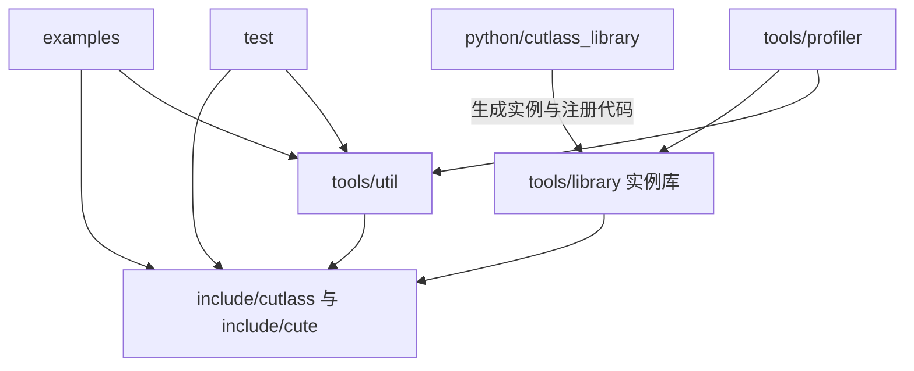

# Q07

会话 ID：`01a14cef-74ca-7232-8887-9a2a16893efc`

仅包含可见的用户问题和助手回复；工具输出、内部推理和环境注入信息不在此导出范围。

---

## 1. 用户

Q07
CUTLASS 仓库完整目录如何组织，各目录之间的依赖关系是什么？
P0
Q08
`include/cutlass` 与 `include/cute` 各自承担什么职责？
P0
Q09
`gemm/device`、`gemm/kernel`、`gemm/collective` 的调用和类型依赖关系是什么？
P0
Q10
`cute/atom`、`cute/arch`、`cute/algorithm` 的分层边界是什么？
P0
Q11
`examples`、`test`、`tools/profiler` 如何与核心库关联？
P1
Q12
如何从一个 GEMM 示例反向定位所有涉及的类、模板特化与关键源码？
P0

---

## 2. 助手

我会先检查项目中的 CUTLASS 参考材料，按 Q07–Q12 梳理目录职责、依赖关系和 GEMM 源码追踪路径，并标明所依据的版本。

---

## 3. 助手

已找到本地 CUTLASS 源码，当前提交为 `ffa119a1`，与项目已有的 SM100 调用链指南一致。下面会以这份源码为准，并区分 2.x 与 3.x 风格 API，避免把旧的 `threadblock/warp` 路径和新的 `collective` 路径混在一起。

---

## 4. 助手

以下以你本机的 [CUTLASS 仓库](E:/000wsp/01repo/08sutlass/cutlass)为准：提交 **`ffa119a1`**，`version.h` 中版本号为 **4.8.0**。重点讨论 C++ 模板库及其 **3.x 风格 GEMM API**；仓库中仍保留大量 2.x 风格实现。“CUTLASS 版本是 4.x”和“使用 3.x 风格 API”并不矛盾。

理解整个仓库，最关键的是分清两条线：**编译期由模板组装出具体 kernel 类型；运行时由 Device API 启动该 kernel。**

**Q07 · P0：CUTLASS 仓库完整目录如何组织，各目录之间的依赖关系是什么？**

下面覆盖当前提交的全部顶层目录，并展开与 GEMM 最相关的部分；未逐一罗列所有示例和架构特化文件。

```text
cutlass/
├── include/                       C++ 核心头文件
│   ├── cutlass/
│   │   ├── arch/                  架构标签、指令及同步等底层设施
│   │   ├── gemm/                  GEMM 类型、组件与设备接口
│   │   │   ├── device/            Host 端接口及启动管理
│   │   │   ├── kernel/            完整 GEMM kernel 的组织
│   │   │   ├── collective/        3.x 风格 mainloop 组件
│   │   │   │   └── builders/      根据配置选择具体实现
│   │   │   ├── threadblock/       传统 CTA 级组件
│   │   │   ├── warp/              传统 warp 级组件
│   │   │   └── thread/            传统线程级组件
│   │   ├── epilogue/              累加结果处理、融合及输出写回
│   │   ├── pipeline/              异步流水线及同步协议
│   │   ├── conv/                  卷积
│   │   ├── reduction/             归约
│   │   ├── transform/             数据类型、布局等变换
│   │   ├── layout/                CUTLASS 布局标签和映射
│   │   ├── thread/                通用线程级运算
│   │   ├── platform/              平台兼容设施
│   │   ├── detail/                内部实现辅助
│   │   ├── experimental/          实验性组件
│   │   └── *.h / *.hpp            数值类型、数组、转换等基础设施
│   └── cute/
│       ├── algorithm/             copy、gemm 等张量算法
│       ├── atom/                  指令 traits、Atom 与 Tiled 抽象
│       ├── arch/                  架构指令包装
│       ├── container/             tuple 等容器
│       ├── numeric/               数值运算设施
│       ├── util/                  辅助设施
│       └── *.hpp                  Shape、Stride、Layout、Tensor 等
├── examples/                      可运行示例，含 C++、CuTe、Python 示例
├── test/                          单元测试、示例测试及测试辅助设施
├── tools/
│   ├── util/                      数据分配、初始化、reference、比较等
│   ├── library/                   kernel 实例库与运行时统一接口
│   └── profiler/                  实例筛选、正确性验证、性能测量
├── python/
│   ├── cutlass_library/           实例描述、代码生成及 manifest 生成
│   ├── cutlass_cppgen/            C++ kernel 生成接口
│   ├── CuTeDSL/                   Python CuTe DSL 相关内容
│   ├── pycute/                    Python 布局代数相关设施
│   ├── docs/
│   └── docs_src/
├── operators/                     面向 Python DSL kernel 的 Operator API
├── cutlass_compiler/              CuTe IR / MLIR 编译器相关工程
├── cmake/                         构建辅助模块
├── media/                         文档源文件、图片等资料
├── docs/                          文档站点与生成的 API 文档等
└── .github/                       CI 与 GitHub 工程配置
```

根目录的 `CMakeLists.txt`、`CUDA.cmake`、`cuBLAS.cmake`、`cuDNN.cmake` 和 Python 打包文件负责构建与集成；它们不是 GEMM 算法实现层。

从**组件使用关系**看：



核心 C++ 模板库主要是 header-only。普通程序可以直接实例化模板，不必依赖 Profiler 或实例库。`tools/library` 则把选定模板配置编译成可通过统一运行时接口调用的实例。官方的[目录组织说明](https://docs.nvidia.com/cutlass/4.4.0/media/docs/cpp/code_organization.html)也按核心库、实例库、工具、示例、测试来划分这些部分。

特别注意：上图表达的是组件职责。**不要据此假定所有头文件的 `#include` 关系都是严格单向的。**

**Q08 · P0：`include/cutlass` 与 `include/cute` 各自承担什么职责？**

可以分别理解为：**CUTLASS 负责组织完整计算，CuTe 负责表达线程、数据和指令之间的映射。**

| 维度 | `include/cutlass` | `include/cute` |
|---|---|---|
| 核心问题 | 如何实现、组装和启动高性能 GEMM 等运算 | 如何描述多维数据，并将其分配给线程和硬件指令 |
| 典型对象 | `GemmUniversalAdapter`、`GemmUniversal`、`CollectiveMma`、`CollectiveEpilogue` | `Shape`、`Stride`、`Layout`、`Tensor`、`MMA_Atom`、`TiledMMA`、`Copy_Atom` |
| 主要职责 | 调度、mainloop、epilogue、流水线、参数转换、启动 | 布局代数、张量切分、线程分工、指令操作数映射 |
| 典型使用 | 组合出完整 GEMM 算子 | 在 collective 或手写 kernel 内描述搬运和 MMA |
| 能否独立作为编程入口 | 可以 | 可以直接使用 CuTe 编写 CUDA kernel |

例如，CUTLASS collective 决定什么时候加载下一块 A/B、什么时候执行 MMA；CuTe 帮助描述“哪个线程持有哪些元素”“这些元素如何对应到一次 MMA 的操作数”。

两点边界需要明确：

- `cutlass::layout::RowMajor` 等通常是运算接口使用的布局标签；`cute::Layout<Shape, Stride>` 是可组合的布局映射。Builder 可以把前者转换成后续 CuTe 实现所需的 stride 类型。
- CuTe 在概念上是基础抽象，但当前源码并非完全独立于 CUTLASS：例如 [`cute/numeric/numeric_types.hpp`](E:/000wsp/01repo/08sutlass/cutlass/include/cute/numeric/numeric_types.hpp:36)复用 CUTLASS 数值类型，[`cute/util/type_traits.hpp`](E:/000wsp/01repo/08sutlass/cutlass/include/cute/util/type_traits.hpp:32)也包含 CUTLASS 基础头文件。

因此，移植时不能只复制 `include/cute`，就默认已获得无外部依赖的完整库。

**Q09 · P0：`gemm/device`、`gemm/kernel`、`gemm/collective` 的调用和类型依赖关系是什么？**

三层各自回答一个问题：

| 层 | 负责的问题 | 典型对象 |
|---|---|---|
| `gemm/device` | Host 如何检查参数、准备 workspace、启动计算？ | `GemmUniversalAdapter<GemmKernel>` |
| `gemm/kernel` | 完整 kernel 如何协调调度、mainloop、epilogue 和同步？ | `GemmUniversal<...>` |
| `gemm/collective` | 一组协作线程如何完成 mainloop 的加载与乘累加？ | `CollectiveMma<...>` |

其中，**epilogue 对应的 collective 在 `epilogue/collective`，不在 `gemm/collective`。**

编译期的类型组装通常是：

```cpp
using CollectiveEpilogue =
    typename EpilogueBuilder<...>::CollectiveOp;

using CollectiveMainloop =
    typename MainloopBuilder<...>::CollectiveOp;

using GemmKernel = cutlass::gemm::kernel::GemmUniversal<
    ProblemShape,
    CollectiveMainloop,
    CollectiveEpilogue,
    TileScheduler
>;

using Gemm =
    cutlass::gemm::device::GemmUniversalAdapter<GemmKernel>;
```

这里 `MainloopBuilder`、`EpilogueBuilder` 是示意名称，分别代表两个命名空间中的 `CollectiveBuilder`。

类型依赖的关键是：

1. **Builder 选择实现。** 架构、数据类型、布局、tile、cluster、schedule 等参数决定匹配哪个 Builder 特化，再得到具体 `CollectiveMma` 或 `CollectiveEpilogue` 类型。
2. **Kernel 消费 collective 类型。** Kernel 从 mainloop 取得 `DispatchPolicy`、`TiledMma`、`TileShape`、`Arguments`、`Params` 等；再结合 epilogue 与 scheduler 组织完整执行。
3. **Device adapter 消费 kernel 类型。** 它包装 kernel 的参数接口、workspace 接口和启动方式。

还有一条容易忽略的依赖：mainloop 的自动 stage 数可能依赖 epilogue 的共享内存占用。本地示例使用：

```cpp
StageCountAutoCarveout<
    sizeof(typename CollectiveEpilogue::SharedStorage)
>
```

所以示例通常先构造 epilogue 类型，再构造 mainloop 类型。

运行时则沿相反方向进入：

```text
用户构造 Gemm::Arguments
  → 查询 workspace 大小、检查可实现性
  → Gemm::initialize(...)
      → GemmKernel::to_underlying_arguments(...)
      → 形成 kernel Params
  → Gemm::run(...)
      → CUDA 普通启动或 cluster 启动
      → cutlass::device_kernel<GemmKernel>
      → GemmKernel::operator()(...)
          → 调度输出 tile
          → collective 加载 / MMA / 同步
          → epilogue 处理与写回
```

具体 kernel 可能让不同 warp 分别执行加载、MMA 和 epilogue，不能把最后三步理解成所有线程顺序调用三个函数。源码入口可从 [`gemm_universal_adapter.h`](E:/000wsp/01repo/08sutlass/cutlass/include/cutlass/gemm/device/gemm_universal_adapter.h:123)和 [`device_kernel.h`](E:/000wsp/01repo/08sutlass/cutlass/include/cutlass/device_kernel.h:84)开始。

另外，`gemm_universal.hpp` 主要汇集声明和架构实现头文件。真正的 `GemmUniversal` 特化通常在 `sm90_*`、`sm100_*` 等文件中。这也是[官方 3.x GEMM API 文档](https://github.com/NVIDIA/cutlass/blob/main/media/docs/cpp/gemm_api_3x.md)强调的源码组织方式。

**Q10 · P0：`cute/atom`、`cute/arch`、`cute/algorithm` 的分层边界是什么？**

按从硬件到算法的方向理解：

```text
cute/arch       一次硬件操作如何发出？
    ↑
cute/atom       该操作需要什么数据映射，如何扩展成 tiled 操作？
    ↑
cute/algorithm  对 Tensor 应用 copy / gemm 等操作时如何展开与分派？
```

| 目录 | 主要内容 | 不负责的事情 |
|---|---|---|
| `arch` | PTX/架构指令包装、寄存器签名、描述符参数、架构能力检查 | 完整 GEMM 调度和 mainloop |
| `atom` | `MMA_Traits`、`Copy_Traits`、`MMA_Atom`、`Copy_Atom`、`TiledMMA`、`TiledCopy` | Host 启动和完整设备算子接口 |
| `algorithm` | 对 Tensor 的算法重载、形状适配、循环展开和向 Atom 的分派 | 自动提供完整的 CUTLASS GEMM kernel |

以 MMA 为例：

```text
cute::gemm(...)
  → 匹配 Tensor / MMA_Atom 对应的算法重载
  → MMA_Atom::call(...)
  → traits 对操作数进行解包或转换
  → arch 操作的 fma(...)
  → PTX MMA 指令
```

关键源码包括：

- [`algorithm/gemm.hpp`](E:/000wsp/01repo/08sutlass/cutlass/include/cute/algorithm/gemm.hpp:40)：算法重载与分派。
- [`atom/mma_atom.hpp`](E:/000wsp/01repo/08sutlass/cutlass/include/cute/atom/mma_atom.hpp:49)：Atom；同文件也定义 `TiledMMA`。
- [`atom/mma_traits_sm100.hpp`](E:/000wsp/01repo/08sutlass/cutlass/include/cute/atom/mma_traits_sm100.hpp:220)：SM100 指令对应的 traits。
- [`arch/mma_sm100_umma.hpp`](E:/000wsp/01repo/08sutlass/cutlass/include/cute/arch/mma_sm100_umma.hpp:86)：SM100 UMMA 指令包装。

这里的 `Atom` 表示对硬件基本操作及其映射的抽象，并不意味着一定由单线程执行。现代 MMA 可能涉及 warp、warpgroup 或跨 CTA 的协作。

另外，`cute::gemm` 是 CuTe 的张量算法接口，不能等同于能直接接收任意大矩阵并启动完整计算的 Device GEMM API。

**Q11 · P1：`examples`、`test`、`tools/profiler` 如何与核心库关联？**

它们都是核心库的使用者，但验证目的不同。

| 目录 | 如何关联核心库 | 阅读价值 |
|---|---|---|
| `examples` | 直接构造模板类型、准备数据、启动算子并验证结果 | 学习具体配置和最小使用方法 |
| `test` | 实例化核心类型，通过 testbed 覆盖多种输入和边界情况 | 确认配置支持范围与正确性约束 |
| `tools/profiler` | 通过实例库的运行时描述和接口选择、执行已编译 kernel | 批量测量性能、比较配置 |

`tools/util` 为它们提供分配、初始化、reference 计算、结果比较和计时等设施。源码中出现：

```cpp
#include "cutlass/util/..."
```

实际文件可能来自 `tools/util/include/cutlass/util/`，不能只在 `include/cutlass` 下找。

Profiler 的典型链路是：

```text
python/cutlass_library 描述和生成候选实例
  → 构建目录中的生成源码
  → 编译、注册进 tools/library 实例库
  → Profiler 根据问题和约束筛选
  → 调用具体实例
  → 校验结果、测量性能
```

因此，**Profiler 可运行的 kernel 集合受构建时实例生成和筛选选项限制**；示例能实例化某配置，不代表当前 Profiler 二进制一定包含它。

测试也有类似区别：一个 `TEST` 中的一组类型配置，可以通过 testbed 运行很多矩阵尺寸。测试名里的 `64x128x64` 往往是 tile shape，不是唯一的运行时问题大小。

**Q12 · P0：如何从一个 GEMM 示例反向定位所有涉及的类、模板特化与关键源码？**

建议以“**具体实例的类型链 + 执行链**”为目标。不要从全部 `#include` 文件开始逐个阅读：头文件可能同时包含很多未被当前配置选中的实现。

下面用本地 [`70_blackwell_fp16_gemm.cu`](E:/000wsp/01repo/08sutlass/cutlass/examples/70_blackwell_gemm/70_blackwell_fp16_gemm.cu:94)演示。

**第一步：记录决定特化的配置。**

这个示例的关键配置为：

| 项目 | 示例中的配置 |
|---|---|
| 架构 | `Sm100` |
| 运算类别 | `OpClassTensorOp` |
| A / B | FP16，A RowMajor，B ColumnMajor |
| 累加器 | FP32 |
| C / D | FP32，ColumnMajor |
| MMA tile | `256 × 128 × 64` |
| Cluster | `2 × 2 × 1` |
| Mainloop schedule | `KernelScheduleAuto` |
| Epilogue schedule | `EpilogueScheduleAuto` |
| Stage count | 自动计算，并扣除 epilogue 共享内存 |

运行时的 M/N/K/L、指针和 stride 另看 `Arguments` 构造；不要与上述 tile 配置混用。

**第二步：沿两个 Builder 分别追踪。**

```text
gemm::collective::CollectiveBuilder<配置...>
  → builders/sm100_umma_builder.inl 中匹配的特化
  → DispatchPolicy / TiledMma / Copy / SMEM layout / stage 数
  → CollectiveOp
  → CollectiveMma<具体参数...>
```

本例 dense SM100 Builder 从 [`sm100_umma_builder.inl:169`](E:/000wsp/01repo/08sutlass/cutlass/include/cutlass/gemm/collective/builders/sm100_umma_builder.inl:169)开始；其 `CollectiveOp` 在该文件第 329 行。

Epilogue 需要独立追踪：

```text
epilogue::collective::CollectiveBuilder<配置...>
  → epilogue/collective/builders/ 中匹配的特化
  → CollectiveEpilogue
  → 输出布局、copy 与融合操作
```

判断是否匹配，要看模板参数、`enable_if`、标签继承关系和 `if constexpr` 条件，不能只看文件名。

**第三步：确认 Auto 最终选中的硬件路径。**

本例 mainloop 的 `TiledMma` 进入 [`sm100_make_trivial_tiled_mma()`](E:/000wsp/01repo/08sutlass/cutlass/include/cutlass/gemm/collective/builders/sm100_common.inl:444)。

当前配置中：

```text
KernelScheduleAuto
  + 静态 cluster M = 2
  + tile M = 256
  → 满足该分支的 2SM 条件
  → sm100_make_2sm_trivial_tiled_mma(...)
  → FP16 对应的 SM100_MMA_F16BF16_2x1SM_SS
```

这一点与项目已有指南中的 **tile `64×128×64`、cluster `1×4×1` 的 1SM 测例不同**。不能因为同为 SM100 FP16，就默认指令路径相同。

**第四步：从 policy 找 collective，再找 kernel 特化。**

本例 mainloop 的关键实现路径为：

```text
MainloopSm100TmaUmmaWarpSpecialized<...>
  → CollectiveMma<该 policy, ...>
  → sm100_mma_warpspecialized.hpp
```

Kernel 的关键路径为：

```text
GemmUniversal<ProblemShape, Mainloop, Epilogue, Scheduler>
  → 根据 Mainloop::DispatchPolicy::Schedule 等条件匹配
  → sm100_gemm_tma_warpspecialized.hpp
```

在 [SM100 kernel 实现](E:/000wsp/01repo/08sutlass/cutlass/include/cutlass/gemm/kernel/sm100_gemm_tma_warpspecialized.hpp:87)中，优先读四类内容：

- 类型别名：确认它实际消费的 mainloop、epilogue、scheduler。
- `Arguments` 和 `Params`：确认 Host 参数如何转成设备执行参数。
- `SharedStorage`：确认共享内存被哪些组件占用。
- `operator()`：确认线程角色、调度、加载、MMA、epilogue 与同步顺序。

**第五步：把 Host 启动链和设备指令链接起来。**

本例 Host 启动见 [`70_blackwell_fp16_gemm.cu:394`](E:/000wsp/01repo/08sutlass/cutlass/examples/70_blackwell_gemm/70_blackwell_fp16_gemm.cu:394)：

```text
can_implement(arguments)
  → initialize(arguments, workspace)
  → run()
  → Device adapter 的启动分支
  → device_kernel<GemmKernel>
  → GemmKernel::operator()
```

设备内部继续追踪：

```text
CollectiveMma
  ├── 加载路径：TMA / copy atom → copy traits → arch 指令包装
  ├── 计算路径：TiledMma → MMA_Atom → MMA_Traits → arch::fma → PTX
  └── 同步路径：pipeline → barrier / commit / wait 等设施

CollectiveEpilogue
  └── 累加结果读取 → 融合计算 → 输出搬运与写回
```

要覆盖“所有关键源码”，不能只追 MMA；TMA 描述符、共享内存布局、TMEM、pipeline、scheduler 和 epilogue 都可能决定性能与正确性。

**第六步：用编译结果验证模板判断。**

源码分析后，可以用三种方式闭环：

1. 在独立的小程序中，用 `static_assert` 检查预期类型、shape 或标签；模板诊断也能帮助展开实际类型。
2. 使用与示例相同的架构和编译选项，查看编译器生成的头文件依赖列表，确定实际编译依赖范围。
3. 检查生成的 PTX/SASS，确认目标 MMA、搬运和同步指令确实存在。

其中，**头文件被包含，只能证明它参与编译；不能证明其中某个特化被选中或某条指令被执行。** 类型证据和生成代码需要分别核对。

你已有的 [SM100 1SM GEMM 调用链指南](C:/Users/Luke/.codex/.chatgpt-projects/g-p-6a7c4e38fe348191a166ee0e1d330af6/SM100_f16_GEMM_64x128x64_1SM_调用链指南.md)可以作为第二个对照实例：沿同一套追踪步骤，比较 1SM 与 2SM 在 Builder 条件、Atom 类型、布局和同步协议上的差异。
