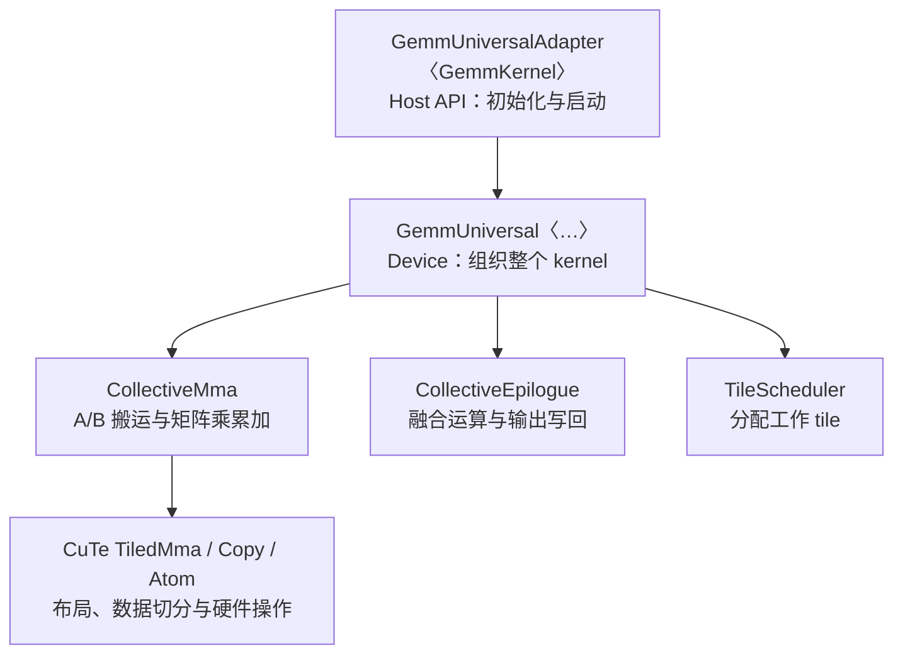

# |   |

会话 ID：`01a14cf0-727a-7fd2-85e3-47d50d426dd9`

仅包含可见的用户问题和助手回复；工具输出、内部推理和环境注入信息不在此导出范围。

---

## 1. 用户

|   |
| - |

顺序

|   |
| - |

重点提问

|   |
| - |

优先级

|   |
| - |

Q20

|   |
| - |

一个 CUTLASS GEMM 从 Host 创建对象到 CUDA Kernel Launch 经历哪些步骤？

|   |
| - |

P0

|   |
| - |

Q21

|   |
| - |

`GemmUniversalAdapter`、`GemmUniversal` 和 `CollectiveMma` 如何关联？

|   |
| - |

P0

|   |
| - |

Q22

|   |
| - |

`Arguments` 如何转换成 `Params`，并传入 Device Kernel？

|   |
| - |

P0

|   |
| - |

Q23

|   |
| - |

`CollectiveBuilder` 如何根据数据类型、GPU 架构、TileShape 自动选择实现？

|   |
| - |

P0

|   |
| - |

Q24

|   |
| - |

Mainloop 如何完成 K 方向循环与 A/B 的加载及 MMA 累加？

|   |
| - |

P0

|   |
| - |

Q25

|   |
| - |

Epilogue 如何执行 Accumulator 的读取、融合计算与输出写回？

|   |
| - |

P0

|   |
| - |

Q26

|   |
| - |

Kernel Scheduler 如何为 CTA/Cluster 分配 GEMM 工作 Tile？

|   |
| - |

P1

---

## 2. 助手

我先查看项目参考材料，再按 Q20–Q26 串起从 Host API 到 GPU 执行的调用链，并标出各层的职责和关键代码位置。

---

## 3. 助手

项目里已有 SM100 1SM GEMM 调用链指南，我确认本地源码与指南记录的提交一致。下面会区分 CUTLASS 3.x 的通用分层和这个 SM100 实例的执行方式，尤其说明编译期 Builder、运行时参数转换，以及 SMEM/TMEM 的分工。

---

## 4. 助手

这七个问题可以沿着一条主线理解：**Builder 在编译期组装类型，Adapter 在 Host 端准备参数并启动 kernel，Kernel 在 GPU 上协调 Scheduler、Mainloop 和 Epilogue。**

下面以 CUTLASS 3.x 的分层方式为主，并结合项目中的 **SM100、FP16 输入、FP32 累加、`64×128×64` tile、`1×4×1` cluster、1SM GEMM** 说明具体实现。我已核对本地源码，提交为 `ffa119a1255d`。涉及 TMA、UMMA、TMEM 的细节属于这个 SM100 实例，其他架构的实现会有所不同。

**Q20｜一个 CUTLASS GEMM 从 Host 创建对象到 CUDA Kernel Launch 经历哪些步骤？**

首先要区分两个阶段：**编译期确定“执行哪种 kernel”，运行时确定“用哪些数据计算多大的问题”。**

编译期通常先构造这些类型：

```cpp
using CollectiveMainloop =
    typename cutlass::gemm::collective::CollectiveBuilder<
        /* 架构、类型、布局、对齐、tile、cluster、stage、schedule */
    >::CollectiveOp;

using CollectiveEpilogue = /* epilogue builder 的输出 */;

using GemmKernel = cutlass::gemm::kernel::GemmUniversal<
    ProblemShape,
    CollectiveMainloop,
    CollectiveEpilogue
>;

using Gemm =
    cutlass::gemm::device::GemmUniversalAdapter<GemmKernel>;
```

运行时的典型流程是：

```text
创建 Gemm 对象
    ↓
构造 Arguments
    ↓
can_implement(args)：检查运行时约束
    ↓
get_workspace_size(args)：查询并分配 workspace
    ↓
initialize(args, workspace, stream)
    ├─ 初始化 workspace
    ├─ Arguments → Params
    └─ 配置所需的动态共享内存上限
    ↓
run(stream)
    ├─ 确定 grid / block / dynamic smem
    ├─ 准备 cluster launch 属性（如果需要）
    └─ 启动 device_kernel<GemmKernel>
            ↓
        GemmKernel::operator()(params, shared_memory)
```

`can_implement()` 与 workspace 查询的先后顺序可以调整；关键是运行前检查约束，并向初始化阶段提供足够的 workspace。

这里有三个容易混淆的点：

- 创建 `Gemm gemm;` 主要是创建 Host 端适配器对象，不会自动分配 A/B/C/D 或执行 GEMM。
- `initialize()` 会准备执行状态；GEMM 的实际 launch 发生在 `run()`。
- `run()` 通常向 CUDA stream 异步提交工作。验证结果或测量执行完成时间时，需要相应的同步机制。

本例使用 cluster 启动路径，经 `ClusterLauncher::launch_with_fallback_cluster()` 启动全局入口。Adapter 的具体实现见 [NVIDIA 源码](https://github.com/NVIDIA/cutlass/blob/ffa119a1255d/include/cutlass/gemm/device/gemm_universal_adapter.h#L313)。

**Q21｜`GemmUniversalAdapter`、`GemmUniversal` 和 `CollectiveMma` 如何关联？**

它们是**逐层组合关系**，主要依靠模板和静态分派：



| 对象 | 主要执行位置 | 核心职责 |
|---|---|---|
| `GemmUniversalAdapter` | Host | 暴露 Device API，管理 `Params`，准备启动配置并 launch |
| `kernel::GemmUniversal` | Device；也提供 Host 静态辅助函数 | 组合 mainloop、epilogue、scheduler，协调线程角色、共享存储和流水线 |
| `CollectiveMma` | Device；也提供参数转换等 Host 辅助函数 | 实现 mainloop 所需的数据搬运和 MMA 累加 |
| `CollectiveEpilogue` | Device；也提供参数转换等 Host 辅助函数 | 消费 accumulator，执行融合计算，存储输出 |

名称对应关系尤其重要：

```cpp
using CollectiveMainloop = /* 某个 CollectiveMma 特化 */;
```

所以后面看到的：

```cpp
collective_mainloop.load(...);
collective_mainloop.mma(...);
```

就是 kernel 在调用选定的 `CollectiveMma` 实现。

**Kernel 决定各角色如何协作；Collective 实现这些角色执行的具体操作。** 在本例中，A/B 加载 warp 和 MMA warp 分别进入 mainloop collective 的不同方法。

**Q22｜`Arguments` 如何转换成 `Params`，并传入 Device Kernel？**

`Arguments` 面向调用者，`Params` 面向选定的 kernel 实现。

| 内容 | `Arguments` 的表达方式 | `Params` 中的处理 |
|---|---|---|
| 问题大小 | M/N/K/L | 保留问题形状，供设备端构造坐标 |
| A/B 数据 | device pointer、stride | 本例生成 A/B TMA 描述符等 mainloop 参数 |
| C/D 与融合计算 | 指针、stride、alpha/beta 等 | 转换为 epilogue 参数及所需描述符 |
| 调度选项 | raster order、swizzle、分解策略等 | 转换为 scheduler 参数及 workspace 引用 |
| workspace | 外部传入的基地址 | 按各模块需求划分并记录相应地址 |

实际调用链如下：

```text
Adapter::initialize(args, workspace)
    ├─ GemmKernel::initialize_workspace(...)
    └─ params_ = GemmKernel::to_underlying_arguments(args, workspace)
                     ├─ CollectiveMainloop::to_underlying_arguments(...)
                     ├─ CollectiveEpilogue::to_underlying_arguments(...)
                     └─ TileScheduler::to_underlying_arguments(...)
```

也就是说，Kernel 层负责把整体参数拆给各子模块转换，再将结果聚合成 `GemmKernel::Params`。

启动时，`Params` 作为 CUDA kernel 参数传给全局包装入口；包装入口取得动态共享内存，然后调用 kernel functor：

```cpp
// 结构示意，省略属性及实现细节
device_kernel<GemmKernel>(Params params) {
    extern __shared__ char smem[];
    GemmKernel op;
    op(params, smem);
}
```

**转换参数不会把矩阵内容搬进 `Params`。** A/B/D 数据仍位于 device memory，`Params` 携带的是访问它们所需的指针、描述符和其他元数据。

代码入口：[Kernel 参数转换](/E:/000wsp/01repo/08sutlass/cutlass/include/cutlass/gemm/kernel/sm100_gemm_tma_warpspecialized.hpp:257)。

**Q23｜`CollectiveBuilder` 如何根据数据类型、GPU 架构、TileShape 自动选择实现？**

`CollectiveBuilder` 的核心机制是：**模板偏特化、编译期条件判断，以及静态约束检查。**

它根据一组输入共同选择实现：

| 输入 | 影响 |
|---|---|
| `ArchTag`、`OpClass` | 可用指令族与实现路径 |
| A/B/Accumulator 类型 | MMA 指令及内部表示 |
| A/B 布局与对齐 | MMA major mode、可用搬运方式及对齐约束 |
| `TileShape_MNK` | MMA 切分、SMEM buffer 大小、指令重复次数 |
| `ClusterShape_MNK` | CTA 协作、multicast，以及部分 1SM/2SM 选择 |
| Stage 策略 | pipeline buffer 的 stage 数 |
| Schedule 标签 | 显式指定或自动选择调度实现 |

对本例，可以把构建过程理解为：

```text
SM100 + TensorOp + FP16 A/B + FP32 accumulator
    ↓
匹配 SM100 dense UMMA builder 特化
    ↓
布局标签 → UMMA major mode
    ↓
tile / cluster / schedule → TiledMma、1SM 或 2SM
    ↓
cluster → A/B TMA copy atom 与 multicast 组织
    ↓
类型 / tile / major → SMEM layout
    ↓
SMEM 容量与 carveout → pipeline stage 数
    ↓
DispatchPolicy + 上述类型 → CollectiveMma
```

本例 `clusterM=1`，自动选择得到 1SM UMMA 路径；epilogue builder 也选择匹配的 1SM 实现。

两个边界需要记住：

- **`Auto` 使用代码中预设的编译期规则，不会在启动时搜索所有实现并现场测速。**
- Builder 不能保证任意配置都合法。不支持的组合可能无法匹配特化或触发静态断言；运行时尺寸、地址对齐等仍由 `can_implement()` 检查。

`StageCountAutoCarveout<sizeof(CollectiveEpilogue::SharedStorage)>` 则使 mainloop 自动确定 stage 数时考虑 epilogue 的共享内存需求。

代码入口：[SM100 mainloop builder](/E:/000wsp/01repo/08sutlass/cutlass/include/cutlass/gemm/collective/builders/sm100_umma_builder.inl:169)。

**Q24｜Mainloop 如何完成 K 方向循环与 A/B 的加载及 MMA 累加？**

对于一个输出 tile，数学上执行：

\[
Acc \leftarrow \sum_t A_t B_t
\]

其中 \(t\) 遍历这个工作单元分配到的 K tiles。普通完整 K 计算时，tile 数大致为 \(\lceil K/B_K\rceil\)；若 scheduler 切分 K，则只遍历分配到的那一段。

本例使用 **warp specialization 加多 stage pipeline**：加载和计算由不同 warp 推进。

加载侧的循环：

```text
等待某个 SMEM stage 可写
    ↓
发出 A/B 的 TMA：GMEM → 该 SMEM stage
    ↓
由异步事务完成机制通知消费者数据就绪
    ↓
推进 producer state 和 K tile iterator
```

MMA 侧的循环：

```text
等待当前 SMEM stage 数据就绪
    ↓
对该 K tile 内的 MMA k-block 发出 cute::gemm
    ↓
结果累加到 TMEM accumulator
    ↓
通过 pipeline 协议释放已消费的 stage
    ↓
推进 consumer state，处理下一个 K tile
```

因此可同时发生：

```text
加载后续 K tile  |  计算当前 K tile  |  epilogue 处理此前完成的输出 tile
```

在这个 SM100 collective 中：

- A/B 存放于多 stage **SMEM** buffer。
- `cute::gemm(tiled_mma, ...)` 对应选定的 **UMMA** 操作。
- accumulator 位于 **TMEM**。
- 第一次 MMA 使用 `ScaleOut::Zero`，后续使用 `ScaleOut::One`，表达初始化累加和继续累加。
- producer/consumer 的 stage 索引和 phase 防止尚未消费的数据被覆盖。

对于 `1×4×1` cluster，沿 N 分布的 CTA 复用相同 M/K 范围的 A，因此可利用 A 的 multicast。

代码入口：[加载循环](/E:/000wsp/01repo/08sutlass/cutlass/include/cutlass/gemm/collective/sm100_mma_warpspecialized.hpp:589)、[MMA 循环](/E:/000wsp/01repo/08sutlass/cutlass/include/cutlass/gemm/collective/sm100_mma_warpspecialized.hpp:652)。

**Q25｜Epilogue 如何执行 Accumulator 的读取、融合计算与输出写回？**

Epilogue 把 mainloop 的累加结果转换成最终输出。常见形式是：

\[
D=\operatorname{convert}_{D}
\left(\alpha Acc+\beta C\right)
\]

若配置了 bias、activation 或其他 fusion operation，还会执行相应计算。

本例的路径为：

```text
等待 accumulator stage 就绪
    ↓
如调度策略需要，先进行部分和 fixup
    ↓
TMEM accumulator → registers
    ↓
fusion callbacks 执行融合计算及输出转换
    ↓
registers → SMEM 输出 stage
    ↓
TMA store：SMEM → GMEM D
    ↓
完成相关流水线释放与尾部等待
```

这里的两个 pipeline 保护不同资源：

- **Accumulator pipeline**：协调 MMA 与 epilogue 对 TMEM stage 的使用。
- **输出 store pipeline**：防止 TMA 尚未读完 SMEM 时，该输出 buffer 就被覆盖。

本例 `ElementC=void`，因此关闭 C source load，计算简化为：

\[
D=\alpha Acc
\]

若启用了 C，则是否实际读取 C 还取决于具体融合运算与运行时参数，不能只由 C 类型判断。

Epilogue 通常按输出 subtile 推进，逐块读取、融合和写回，不必一次把整个 accumulator tile 都装入线程寄存器。

代码入口：[SM100 epilogue store](/E:/000wsp/01repo/08sutlass/cutlass/include/cutlass/epilogue/collective/sm100_epilogue_tma_warpspecialized.hpp:574)。

**Q26｜Kernel Scheduler 如何为 CTA/Cluster 分配 GEMM 工作 Tile？**

Scheduler 解决的是：**当前 CTA/Cluster 计算哪个输出位置、哪个 batch，以及必要时的哪段 K。**

以本例 1SM CTA tile 为 `BM×BN`，输出 tile 网格为：

\[
T_M=\left\lceil M/B_M\right\rceil,\qquad
T_N=\left\lceil N/B_N\right\rceil
\]

Scheduler 将工作映射为类似下面的信息：

```text
WorkTileInfo
    ├─ M tile index
    ├─ N tile index
    ├─ batch index
    ├─ 是否有效
    └─ 按策略携带 K 分段或归约相关信息
```

具体机制取决于 scheduler：

| 方式 | 工作分配方式 |
|---|---|
| 非持久化映射 | CTA 通常根据 `blockIdx` 映射到一个输出 tile |
| 静态 persistent | CTA 完成一个 tile 后，按既定映射继续处理后续 tile |
| 动态 persistent | 通过动态工作获取机制取得后续工作 |
| Stream-K / Split-K 等分解 | 工作还可能沿 K 拆分，需要处理部分和与最终输出 |

本例默认标签映射到 SM100 的 persistent scheduler，使用 CLC 相关机制取得后续工作。Kernel 中有专门的 scheduler warp，由 cluster 的指定 CTA 推进调度，其他角色通过 scheduler pipeline 获取协调一致的工作信息。

对于 `1×4×1` cluster，可把同一 cluster 内的工作理解为：

```text
CTA 0 → (m, n+0)
CTA 1 → (m, n+1)
CTA 2 → (m, n+2)
CTA 3 → (m, n+3)
```

后续工作到来时，各 CTA 再依据 cluster 工作和自身 rank 得到对应坐标。边界处还需处理无效或被裁剪的工作。

Raster order 和 swizzle 会影响 tile 的遍历次序及局部性；若采用 K 分解，scheduler 还需要确定每份工作的 K 范围、是否执行最终 epilogue，以及部分结果如何合并。

**Scheduler 的 K 工作分配与 Mainloop 内部的 K 循环是两层职责：前者分配计算范围，后者执行范围内的加载和 MMA。**

代码入口：[scheduler 类型选择](/E:/000wsp/01repo/08sutlass/cutlass/include/cutlass/gemm/kernel/tile_scheduler.hpp:180)、[Kernel 中 scheduler 初始化](/E:/000wsp/01repo/08sutlass/cutlass/include/cutlass/gemm/kernel/sm100_gemm_tma_warpspecialized.hpp:607)。
