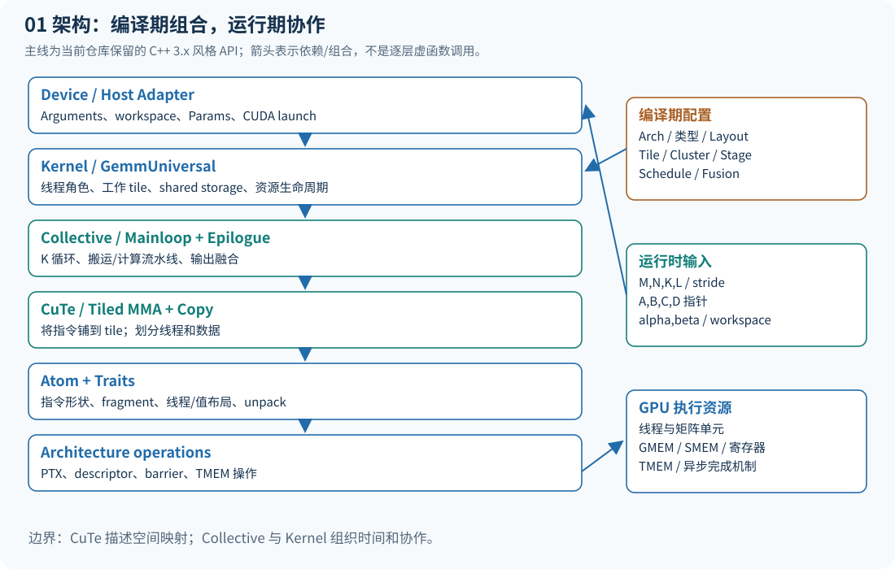
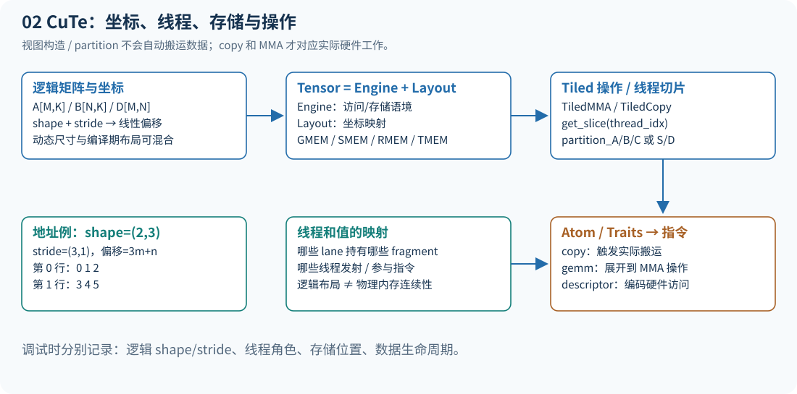
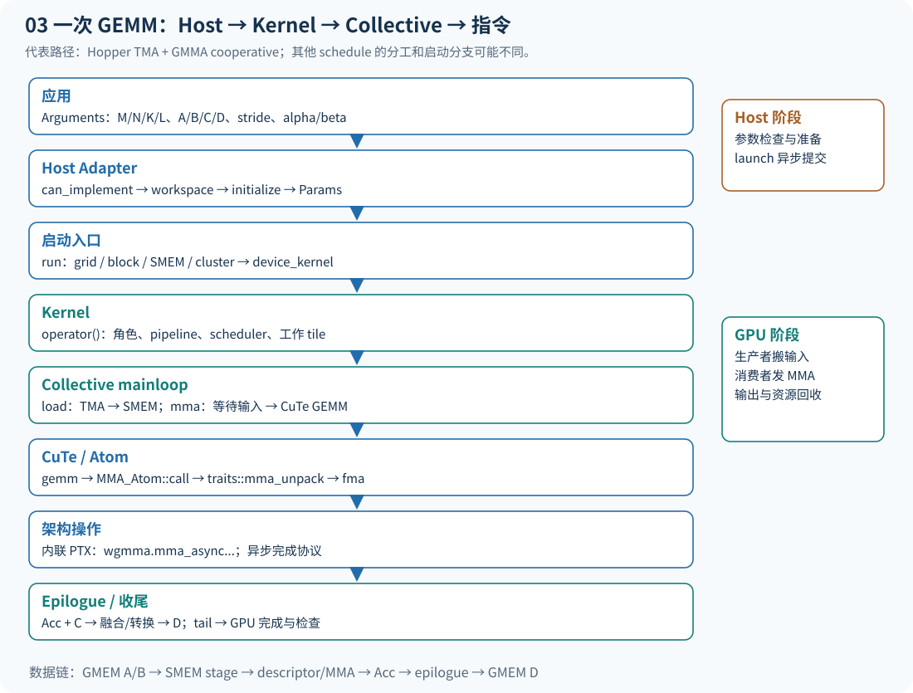
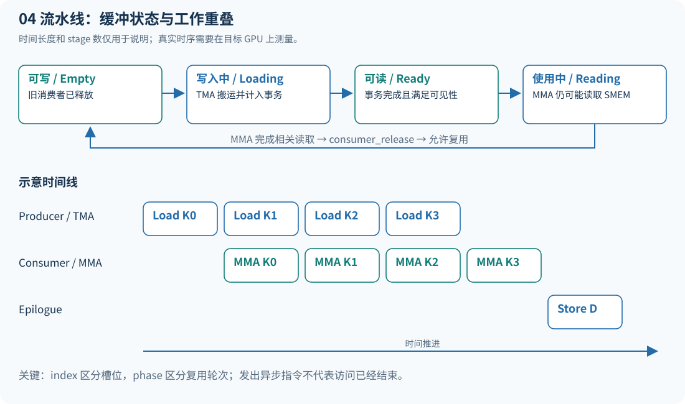
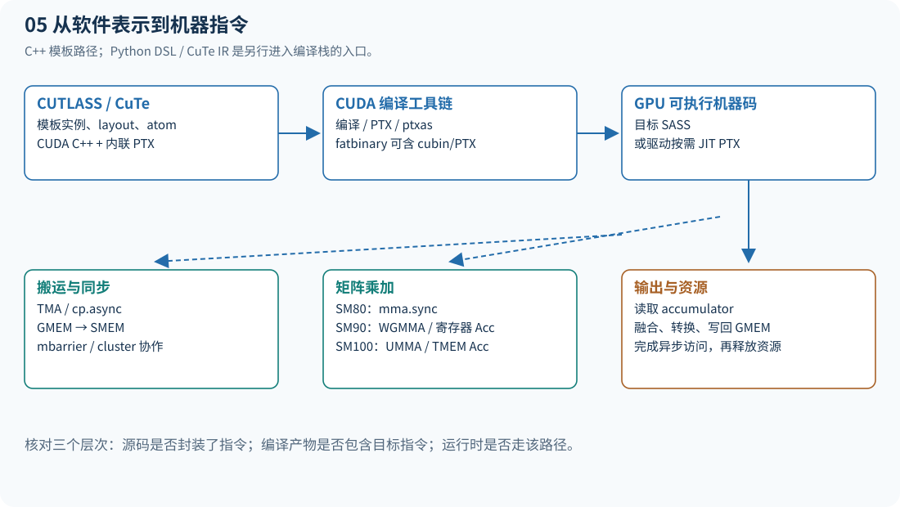
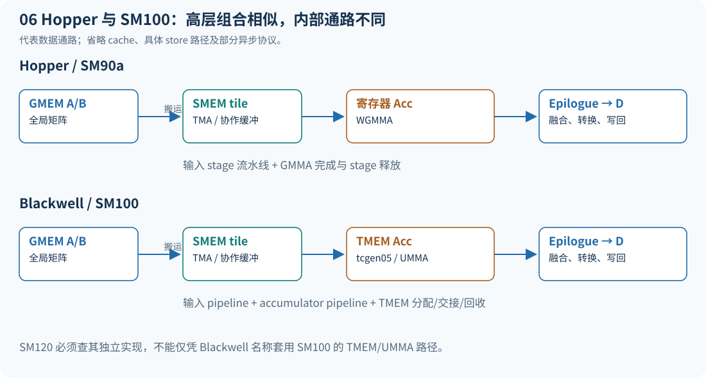
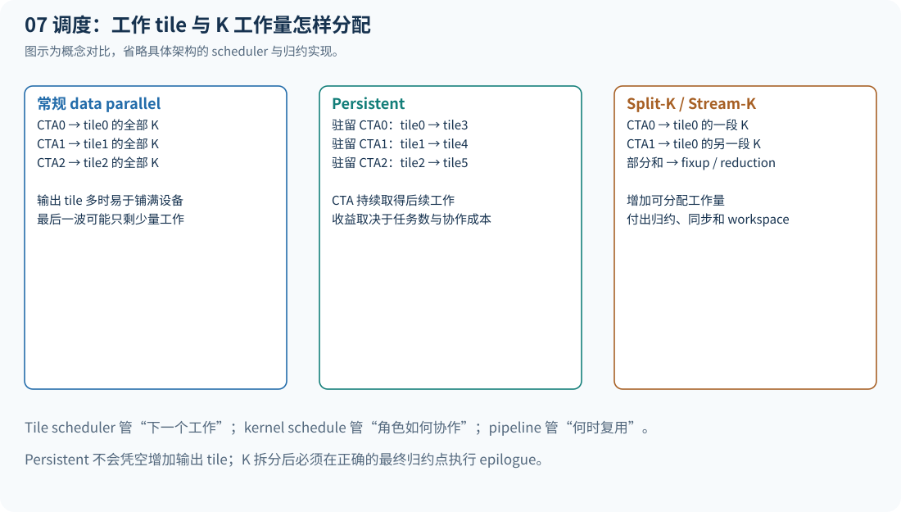
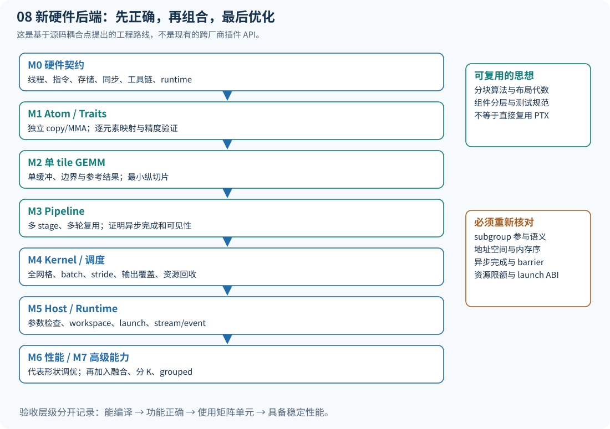

# CUTLASS 源码与架构指南

> 从架构组合，到一次 GEMM 的执行，再到优化与硬件移植。  
> 分析对象：`E:\000wsp\01repo\08sutlass\cutlass`  
> 版本：`CUTLASS 4.8.0` 开发快照，`v4.8.0dev-1-gffa119a1`  
> 提交：`ffa119a1255d78998536107466cc7097ecefa393`  
> 分析日期：2026-10-18。本文所述接口和文件以此工作区快照为准。

## 阅读导航

1. [先建立整体认识](#先建立整体认识)
2. [仓库地图与阅读入口](#仓库地图与阅读入口)
3. [架构分层、抽象边界与组合](#架构分层抽象边界与组合)
4. [CuTe：空间映射的语言](#cute空间映射的语言)
5. [一次 GEMM 的完整执行](#一次-gemm-的完整执行)
6. [从 Hopper 到 Blackwell](#从-hopper-到-blackwell)
7. [调度策略与性能瓶颈](#调度策略与性能瓶颈)
8. [修改与扩展的落点](#修改与扩展的落点)
9. [新增硬件后端的实现路径](#新增硬件后端的实现路径)
10. [构建、验证与性能实验](#构建验证与性能实验)
11. [推荐阅读路线与问题索引](#推荐阅读路线与问题索引)
12. [源码证据索引](#源码证据索引)

## 先建立整体认识

CUTLASS 的核心是**把高性能 GPU 算子的实现拆成可组合的编译期组件**。它提供模板库、CuTe 布局与操作抽象、实例化算子库、性能分析工具，以及 Python DSL 等入口。应用通常选定一组类型、布局、tile 和调度策略，编译器据此生成专用 kernel，再通过 Host 接口传入矩阵地址与问题规模。

本文围绕三个问题展开：

| 核心问题 | 应掌握的主线 | 阅读后的实际能力 |
|---|---|---|
| 如何设计？ | Device → Kernel → Collective → Tiled MMA/Copy → Atom | 判断一个修改属于哪一层，理解模板组合如何生成实现 |
| 如何执行？ | Arguments → Params → launch → 调度 → 搬运 → MMA → epilogue | 从应用参数一路定位到 PTX，以及对应硬件资源 |
| 如何修改、优化、移植？ | 先识别约束，再选择扩展点，最后验证性能 | 区分参数调优、新算子融合、同厂商新架构适配、跨厂商重建 |

有两个方向需要同时理解：**空间映射**决定哪个线程、哪个 lane、哪条指令处理哪个元素；**时间调度**决定什么时候搬运、计算、等待、释放和复用存储。CuTe 主要提供前者的表达工具，Collective 和 Kernel 共同承担后者；两者在 MMA、Copy、barrier 等硬件操作处相接。[S02](#S02)[S03](#S03)



### 本文的边界与证据

主线使用 C++ 的 **3.x 风格 GEMM API**，即当前 4.8 开发仓库仍在使用的 Device/Kernel/Collective 分层。仓库版本号为 4.x，不表示所有 C++ 接口都换成一套名为“4.x GEMM API”的新层级。较早的 2.x API、手写 CuTe kernel、Python DSL 与 CuTe IR 编译器另行解释。

本文直接读取了本地关键实现、示例与文档；“新增非 NVIDIA 后端路线”是基于耦合点提出的工程方案，**不是仓库已有的通用后端插件接口**。当前机器检测到 RTX 4060 Laptop GPU（SM89），因此本文没有运行 Hopper/SM100 kernel，也没有给出这些架构的实测吞吐。文中资源估算和性能判断均标明适用条件。

工作区已有未跟踪的 `.vscode/` 和 `docs/01_mma_sm100_host_device_callchain_zh.md`。分析保留这些内容；已有教程笔记只作为阅读线索，关键调用链以源码重新核对。指南产物放在独立的 `deliverables/cutlass-guide/`，没有修改目标仓库。

## 仓库地图与阅读入口

```text
cutlass/
├── include/
│   ├── cutlass/
│   │   ├── gemm/
│   │   │   ├── device/           Host 侧 GEMM 接口与启动适配
│   │   │   ├── kernel/           整个 kernel、tile scheduler
│   │   │   ├── collective/       3.x 主循环及其 builder
│   │   │   ├── dispatch_policy.hpp  策略标签与主循环 dispatch policy
│   │   │   ├── threadblock/      2.x CTA 级实现
│   │   │   ├── warp/             2.x warp 级实现
│   │   │   └── thread/           2.x 线程级实现
│   │   ├── epilogue/             输出阶段、融合操作、visitor
│   │   ├── pipeline/             异步流水线与状态管理
│   │   └── arch/                 架构标签、barrier、同步等低层设施
│   └── cute/
│       ├── layout*.hpp           布局与布局代数
│       ├── tensor*.hpp           引擎 + Layout 的 tensor 视图
│       ├── algorithm/            copy、gemm 等算法分派
│       ├── atom/                 Copy/MMA traits、Atom、Tiled 操作
│       └── arch/                 架构操作与内联 PTX、descriptor、TMEM
├── examples/
│   ├── 49_hopper_gemm_with_collective_builder/
│   ├── 71_blackwell_gemm_with_collective_builder/
│   ├── cute/tutorial/            CuTe 的较小教学 kernel
│   └── python/CuTeDSL/           Python kernel 示例
├── test/unit/                   组件与算子验证，含架构专用测试
├── tools/
│   ├── library/                 实例化操作与库接口
│   ├── profiler/                操作枚举、正确性与性能测试
│   └── util/                    分配、reference、计时等辅助工具
├── python/                      实例生成器、Python DSL 等
├── operators/                   当前快照的算子集成入口
├── cutlass_compiler/            CuTe IR / MLIR 编译器栈
└── media/docs/                  仓库内官方文档
```

### 三种常见使用入口

| 入口 | 用户直接控制什么 | 适合什么任务 |
|---|---|---|
| C++ Builder + Adapter | 架构、类型、布局、tile、cluster、stage、schedule、融合 | 实例化和定制成熟的 GEMM 实现 |
| 手写 CuTe kernel | Tensor/Layout、线程划分、copy/MMA、同步和 launch | 学习、实验、已有 Collective 难以表达的算法 |
| CuTe DSL | 用 Python 表达相近的 layout/tensor/atom/pipeline 概念 | JIT/AOT 工作流与快速 kernel 开发 |

此外，`tools/library` 和 `tools/profiler` 可以围绕已生成的 kernel 实例枚举、运行和比较；这与直接实例化单个 C++ 模板是两个入口。**单个 `GemmUniversalAdapter<Kernel>` 不会自动枚举整个库并为任意输入找到最优 kernel。**

### 不要把两代 API 的职责一一机械对应

2.x 常见阅读路线是 `device → kernel → threadblock → warp → thread/arch`，许多 iterator、MMA 和 epilogue 类型紧贴 GPU 层级。3.x 风格改用 CuTe 表达线程与数据映射，把 mainloop/epilogue 提升为 Collective。它们在当前仓库并存，`.h`/`.hpp` 文件后缀只能提供线索，不能作为可靠的版本判据。[S02](#S02)[S03](#S03)

## 架构分层、抽象边界与组合

### 各层到底负责什么

| 层 | 核心职责 | 典型类型或入口 | 主要不变量 |
|---|---|---|---|
| Device | 接收参数、检查实现条件、workspace、参数转换、launch | `GemmUniversalAdapter` | 参数、目标架构、启动方式与具体 kernel 一致 |
| Kernel | 线程角色、shared storage、tile 调度、Collective 生命周期 | `kernel::GemmUniversal` 的特化 | 同一工作 tile 的坐标与各参与角色一致，尾部协议完成 |
| Collective | K tile 循环、异步搬运/计算协作；或输出阶段融合与存储 | `CollectiveMma`、epilogue Collective | 数据就绪后才能消费，完成消费后才能复用 |
| Tiled MMA/Copy | 将一个指令级操作在更大 tile 上铺开，给线程切片 | `TiledMMA`、`TiledCopy` | 数据的线程/值映射符合 Atom 的要求 |
| Atom / Traits | 指令形状、数据类型、参与线程、fragment、寄存器/descriptor 接口 | `MMA_Atom`、`Copy_Atom`、`MMA_Traits` | 软件视图与指令操作数 ABI 相符 |
| Architecture 封装 | 发出 PTX、构造硬件 descriptor、管理特定资源 | `cute/arch/*`、`cutlass/arch/*` | 对齐、合法地址空间、同步语义和指令目标正确 |

最后一行是实现落点，通常把前五行称为 GEMM 的五层概念架构。Atom 既需要 Traits 描述语义，也依赖 Architecture 操作对象发出指令。[S03](#S03)[S14](#S14)[S15](#S15)

Collective 不是固定等于“一个 warp”或“一个 CTA”的同义词。其含义是能利用硬件搬运、通信和同步机制协作的一组线程；不同实现可跨 warp，某些能力涉及 cluster 中的 CTA。Kernel 负责把这些协作组织到整个工作网格中。

### 编译期如何组装

`49_collective_builder.cu` 提供了一条清晰的组装链：[S04](#S04)

```cpp
// 结构示意，省略完整模板参数；可编译版本见示例 49。
using Epilogue = typename EpilogueBuilder<...>::CollectiveOp;
using Mainloop = typename MainloopBuilder<
    ..., StageCountAutoCarveout<sizeof(typename Epilogue::SharedStorage)>,
    MainloopSchedule
>::CollectiveOp;
using Kernel = cutlass::gemm::kernel::GemmUniversal<
    cute::Shape<int,int,int,int>, Mainloop, Epilogue, TileSchedulerTag>;
using Gemm = cutlass::gemm::device::GemmUniversalAdapter<Kernel>;
```

这里把 epilogue 放在前面，是为了先知道它需要多少 shared memory，再让 mainloop builder 在剩余预算内选择 stage 数。实际共享存储还包含 barrier、scheduler 等结构，应以最终 `Kernel::SharedStorageSize` 和实现中的 carveout 规则为准。

组合过程主要发生在编译期：

1. Builder 根据 `ArchTag`、数据类型、布局、对齐、tile、cluster 和 schedule 选择模板特化。
2. mainloop builder 选取 MMA 操作、SMEM 布局、copy 原语与 dispatch policy。
3. `GemmUniversal` 按 `DispatchPolicy::Schedule` 等条件匹配具体 Kernel 实现。
4. Adapter 包装这个 Kernel，提供统一的 Host 操作接口。

这是一种模板与标签分派结构，通常没有逐个 tile 经过虚函数分派的开销。编译器能静态推导的循环和映射可能展开；M/N/K、地址和 stride 中的动态部分仍在运行时参与计算。不能把“模板化”理解成“一切工作都在编译期完成”。[S05](#S05)[S06](#S06)

### 三个容易混淆的“调度”

| 名称 | 决定什么 | 修改入口 |
|---|---|---|
| Kernel/mainloop schedule | producer/consumer 如何分工，采用何种搬运和 MMA 协作 | `KernelSchedule...` 标签及其特化 |
| Tile scheduler | CTA/cluster 接下来计算哪个 M/N/K/L 工作 tile | `PersistentScheduler`、`StreamKScheduler` 等 |
| Pipeline schedule / stage | 一个 tile 内不同批次的搬运、MMA、输出如何重叠 | stage 数、PipelineState、barrier 协议 |

`KernelScheduleAuto` 和 `StageCountAuto` 是 builder 的选择规则，不等于针对当前输入执行在线全局性能搜索。更换 tile scheduler 也不自动重写 mainloop 内部的流水线。[S04](#S04)[S05](#S05)[S20](#S20)

## CuTe：空间映射的语言

### Tensor、Layout 与真正的数据移动

CuTe 的 `Layout` 表示从逻辑坐标到线性索引的映射。最直观的例子：

```text
shape  = (2, 3)
stride = (3, 1)
offset(m,n) = 3*m+n

        n=0  n=1  n=2
m=0       0    1    2
m=1       3    4    5
```

stride 通常以元素为单位；计算实际字节地址时还涉及元素类型、recast 和存储方式。对于 sub-byte 数据，不能简单把每个逻辑元素当成独立字节。

`Tensor` 可理解为 **Engine（存储/访问引擎）+ Layout**。它可以是现有 GMEM/SMEM 数据的视图，也可以承载寄存器 fragment 等。`make_tensor(pointer, layout)` 本身通常只建立视图；对视图进行 partition、slice、tile，不表示已经把数据从 GMEM 搬到了 SMEM。执行搬运的是后续 `copy`，执行乘加的是 `gemm` 分派到的 Atom。[S21](#S21)[S22](#S22)



### 布局代数解决什么问题

| 操作/概念 | 要回答的问题 | 阅读时的注意点 |
|---|---|---|
| `composition` | 两套坐标映射串起来后，最终访问哪里？ | 对比定义域和值域，不能按字符串理解 |
| divide / product | 如何把一个区域分块，或把小布局铺成大区域？ | 层次 shape 的每个 mode 有具体含义 |
| `local_tile` | 当前 CTA/工作 tile 对应全局矩阵哪一块？ | tile 坐标与 K tile 的保留维度 |
| `partition_A/B/C` | 当前线程在 MMA 操作里看到哪些输入和结果？ | 这是指令需要的映射，未必是连续数组 |
| `partition_S/D` | 当前 copy 线程从哪里读、向哪里写？ | 源与目标的元素集合及向量宽度必须匹配 |
| Swizzle | SMEM 物理地址如何排列以满足指令/减少冲突？ | 改动后必须同步校验 copy 和 MMA descriptor |

`Layout` 不只是传统 row-major/column-major 的包装。它还用于表达线程 ID、lane、value、M/N/K 模式以及组合后的映射；布局代数把这些关系变成可以计算和静态检查的对象。[S23](#S23)

### 从一个 Atom 到更大 tile

一个 MMA Atom 定义一种指令的逻辑工作：例如 M×N×K 形状、A/B/C 数据类型，以及线程和值如何分布。`make_tiled_mma` 将 Atom 在线程和值空间中铺开，形成更大的 TiledMMA；`get_slice(thread_idx)` 再提供单个线程的切片视角。[S14](#S14)

这条关系不应理解为“每个线程独立执行一次完整的小 GEMM”。某些指令由一个 warp 协作执行，Hopper WGMMA 涉及 warpgroup；SM100 UMMA 又有不同的发射与参与语义。逻辑计算覆盖范围、指令发射线程和实际参与的数据范围需要分开阅读。

### 一次源码调试应记录四张表

1. **逻辑表**：A、B、C/D 各 mode 的含义、shape 和 stride。
2. **线程表**：CTA、warpgroup、warp、lane 分别负责什么。
3. **存储表**：当前对象是 GMEM 指针、SMEM 视图、寄存器 fragment、descriptor 还是 TMEM 地址。
4. **时序表**：谁写入、谁等待、谁读取、何时允许覆盖。

很多“数值随机错误”来自第三、四张表；很多“编译通过但慢”来自第二、三张表。

## 一次 GEMM 的完整执行

### 先固定数学约定

标准语义是 `D = alpha × A × B + beta × C`。本文用数学形状 A[M,K]、B[K,N]、C/D[M,N]；CuTe/CUTLASS 内部常把 B 表成 **[N,K,L] 逻辑模式**，由 stride 指定如何映射到实际存储，这不等于额外生成了一个转置矩阵。批量维度通常记为 L，问题形状为 `[M,N,K,L]`。[S03](#S03)[S04](#S04)

本文主线选择 **Hopper + TMA + GMMA + cooperative warp specialization** 的已存在实现。示例 49 同时实例化多个 schedule；不要把其默认 Auto 配置与本文选定的 cooperative 路径直接当成同一个具体实例。



### 阶段一：应用构造运行时 Arguments

在示例 49 中，应用分配和初始化 A/B/C/D，构造 stride 和 `problem_size`，再创建 `Gemm::Arguments`：[S07](#S07)

```text
Arguments
├── mode                 kGemm 等运行模式
├── problem_shape        M,N,K,L
├── mainloop             A/B 指针、各自 stride
├── epilogue             alpha/beta 或 visitor 参数、C/D 指针与 stride
├── hw_info              device、SM 数等硬件信息
└── scheduler            当前 scheduler 所需的运行参数（若适用）
```

数据类型、layout 的静态部分、tile 形状和采用哪套指令通常已经由模板类型固定。运行时仅修改 Arguments，并不能让同一个 kernel 类型任意切换 FP16/FP8、SM90/SM100 或任意 SMEM 布局。

### 阶段二：Host Adapter 检查与准备

典型调用顺序是：

```cpp
Gemm op;
auto bytes = Gemm::get_workspace_size(args);
// 按 bytes 分配 workspace；生命周期必须覆盖 GPU 使用期。
check(op.can_implement(args));
check(op.initialize(args, workspace, stream));
check(op.run(stream));
// 使用事件或同步点确认 GPU 完成，再检查运行错误、读取结果。
```

这是结构示意，`check` 和分配细节由应用实现。示例 49 在 launch 后调用 `cudaDeviceSynchronize()` 并做 reference 校验；生产集成通常使用 stream 和 event 组织依赖。[S07](#S07)

Adapter 的实现承担以下工作：[S08](#S08)[S09](#S09)

- `can_implement`：调用具体 Kernel 的约束检查；覆盖范围依实现而定，不能代替整个 CUDA 环境和内存生命周期检查。
- `get_workspace_size`：统计 kernel、scheduler、归约等所需空间；有些实例可以为零。
- `initialize`：初始化 workspace，调用 `GemmKernel::to_underlying_arguments` 生成更适合 device 的 `Params`，设置必要的动态 SMEM 属性。
- `run`：取得 block/grid/shared-memory 配置，按架构与 cluster 形状选择启动路径。

`Arguments → Params` 不是单纯复制结构。它可能构造 TMA descriptor、准备 scheduler 参数、划分 workspace，以及把高层形状降为设备执行所需表示。查看 `sm90_gemm_tma_warpspecialized_cooperative.hpp` 的转换函数可看到 mainloop、epilogue、scheduler 各自的参数转换。[S10](#S10)

Adapter 有缓存参数的运行重载，也有接收新 Arguments 的运行重载。重复调用前确认自己是否需要重新初始化或更新参数；仅改变外部 `args` 并不一定改变 Adapter 已缓存的 `params_`。

### 阶段三：启动 CUDA kernel

`run` 并非所有架构都使用同一条裸 `<<<grid,block>>>` 路线。当前实现按架构、静态/动态 cluster、Host Adapter、PDL 等情况分支；Hopper 非 1×1×1 cluster 可通过 `ClusterLauncher::launch` 启动，SM100 分支还处理 fallback cluster。[S09](#S09)

最终的 `device_kernel<Operator>` 是一个很薄的 CUDA 入口：取得动态 SMEM，构造 Operator，然后调用 `op(params, smem)`。主逻辑在具体 `GemmUniversal` 的 `operator()` 中。[S11](#S11)

**返回成功不等于 GPU 已完成。** launch 可以异步提交，错误也可能在后续同步点暴露。指针、workspace、输入输出与 stream 依赖都必须保持有效。

### 阶段四：Kernel 组织角色和工作 tile

Hopper cooperative Kernel 的核心职责包括：[S06](#S06)[S12](#S12)

1. 从参数取得 problem shape、mainloop/epilogue 参数与 scheduler。
2. 在 shared storage 中组织数据缓冲、pipeline/barrier 与 scheduler 状态。
3. 区分 producer 与 consumer warpgroup，以及 producer 内的 mainloop/epilogue 等角色。
4. 构造对应 Pipeline 与初始 PipelineState。
5. 由 scheduler 提供工作 tile；不同角色对同一工作采用匹配的坐标与 K 范围。
6. producer 调用 `collective_mainloop.load`，consumer 调用 `collective_mainloop.mma`；按需求执行 epilogue 的 load/store。
7. 取得下一工作 tile，最后完成 load/mma/store 的 tail，避免尚未完成的异步访问与提前退出。

```text
device_kernel<Kernel>
└── Kernel::operator()(Params, shared_memory)
    ├── 建立角色、Pipeline、PipelineState、TileScheduler
    ├── producer 路径
    │   ├── scheduler.initial_work_tile_info / fetch_next_work
    │   ├── CollectiveMainloop::load_init
    │   ├── CollectiveMainloop::load
    │   └── load_tail
    └── consumer 路径
        ├── 获取匹配工作 tile
        ├── CollectiveMainloop::mma / mma_tail
        ├── scheduler fixup（需要跨工作项归约时）
        ├── CollectiveEpilogue::store
        └── store_tail
```

上图是职责树，省略了特定 schedule 的辅助角色、epilogue load 与分支；完整实现不是每个线程依次跑完这棵树。

对本文选定的 Hopper cooperative 代表配置，builder 的 `AtomLayoutMNK = Layout<Shape<_2,_1,_1>>` 形成两组 MMA warpgroup；Kernel 定义一个 load warpgroup 和两个 consumer warpgroup，总计通常为 384 个线程。producer 内不同 warp 再承担 mainloop load、调度或 epilogue load 等角色；具体工作取决于 scheduler 和辅助加载分支。这个数字来自该特化和 TiledMMA 配置，不能推广到其他 SM90 schedule。源码中的 `NumMMAThreads = size(TiledMma{})` 与 `MaxThreadsPerBlock` 是最终判断依据。[S05](#S05)[S06](#S06)

### 阶段五：Collective 把 A/B 送入 SMEM

以 `sm90_mma_tma_gmma_ss_warpspecialized.hpp` 为例，`load_init` 建立全局 tensor 与相关 tile 视图；`load` 对输入进行 TMA 分区，计算 cluster multicast mask，然后循环处理 K tile。[S13](#S13)

关键顺序是：

```text
producer_acquire(write_state)
    → 确认该 SMEM stage 可复用，并登记本轮期望事务字节
    → 取得此 stage 的 TMA barrier
    → copy(TMA_A.with(barrier, mask), A_tile, A_smem_stage)
    → copy(TMA_B.with(barrier, mask), B_tile, B_smem_stage)
    → 推进 write_state，继续下一 K tile
```

TMA load 本身异步执行。消费者等待的是硬件完成事务后变为就绪的 barrier。**不能机械地在每次 TMA `copy` 后加一个通用 `producer_commit`，并假定这一步让数据就绪。**当前 `PipelineTmaAsync` 的正常 TMA commit 路径依赖事务完成；源码里对应 `producer_commit(stage, bytes)` 标明正常 TMA 主循环下为 NOP，测试模拟路径另行处理。[S18](#S18)

### 阶段六：消费 stage，发出 WGMMA

`mma` 侧建立指向 SMEM operand 的 descriptor fragment 和累加器 fragment。每个 K tile 的关键顺序可概括为：[S13](#S13)

```text
consumer_wait(read_state)          等输入事务完成
warpgroup fence / arrive           满足 GMMA 的操作数与发射协议
cute::gemm(tiled_mma, A, B, accum)  发出一组 MMA
warpgroup_commit_batch()          提交异步 MMA 批次
warpgroup_wait<...>()              等足够早的 MMA 完成
consumer_release(release_state)    释放已完成使用的旧 stage
```

read、write、release 可能是不同状态：计算可以有多批在飞，不能发出 MMA 就立即覆盖它仍在读取的 SMEM。最后 `mma_tail` 等待剩余 MMA，并释放尚未释放的 stage。



图中的 stage 数和时间块长度是说明性示意，不代表示例 49 的实测调度。真正的正确性约束是：**写入完成 → 允许读取；读取完成 → 允许再次写入**。`PipelineState` 的 index 与 phase 一起区分 ring buffer 的不同轮次，单独使用 `k % stages` 不足以表达完整协议。

### 阶段七：CuTe 如何走到 PTX

Hopper 的典型分派路径如下：[S14](#S14)[S15](#S15)[S16](#S16)[S17](#S17)

```text
cute::gemm(tiled_mma, ...)
  → algorithm/gemm.hpp 的形状与布局重载
  → MMA_Atom::call(...)
  → 对该 MMA_Traits 适用的 mma_unpack(...)
  → MMA operation 的 fma(...)
  → cute/arch/mma_sm90_gmma.hpp 中内联 PTX
  → wgmma.mma_async.sync.aligned....
```

普通寄存器 MMA 的 generic `mma_unpack` 会将 fragment recast 成指令要求的寄存器参数并展开到 `MMA_Op::fma`。Hopper GMMA 有其专用重载，处理 A/B descriptor 与原地累加等语义，不能拿 generic 的“四个寄存器 tensor”接口逐字解释所有架构。

例如 `MMA_64x8x16_F32F16F16_SS` 封装中可直接看到：

```text
wgmma.mma_async.sync.aligned.m64n8k16.f32.f16.f16
```

这个指令只是仓库中已核对的一个代表 Atom；具体 builder 可能为更大 N 选择另一形状，不能据此断言示例 49 所有实例都使用 `m64n8k16`。

搬运路径与此并列：`cute::copy` → Copy Atom/Traits → TMA 操作封装，最终出现 `cp.async.bulk.tensor...mbarrier::complete_tx::bytes` 等 PTX。[S19](#S19)

### 阶段八：PTX 到 GPU 硬件

PTX 是 NVIDIA 的虚拟指令集。通常编译流程由 CUDA 编译器生成/处理 PTX，再经 `ptxas` 生成目标 GPU 的 SASS；fatbinary 也可包含 PTX，由驱动在需要时 JIT。**GPU 最终执行目标机器指令，源码中的 PTX 封装不是跨厂商硬件接口。**指令合法性和异步完成规则应以对应 PTX ISA 为准。[官方 PTX ISA](https://docs.nvidia.com/cuda/parallel-thread-execution/)



| 软件操作 | 主要硬件资源/机制 | 阅读中要核对的内容 |
|---|---|---|
| TMA load/multicast | 异步搬运、SMEM、cluster、mbarrier | descriptor、地址空间、事务字节、接收 mask |
| WGMMA | Tensor Core、warpgroup、SMEM operand、寄存器累加 | 参与线程、操作数就绪、批次完成 |
| SM100 UMMA | Tensor Core、SMEM/TMEM、异步完成机制 | TMEM 生命周期、1SM/2SM 模式与协调 |
| epilogue | 寄存器计算、SMEM 重排、全局存储等 | 输出映射、融合逻辑、类型转换与尾部 |
| tile scheduler | CTA/cluster 工作分配及相关状态 | 覆盖、唯一写入、K 拆分和归约 |

### 阶段九：Epilogue 与最终结果

累加器中的 `Acc` 还不是最终 D。epilogue 可以读入 C，计算 alpha/beta、bias、激活、scale 或其他支持的融合表达式，再转换到输出类型并写入 D。有些实现通过 SMEM 重排，再利用 TMA store；有些采用不同的直接存储方式。[S24](#S24)[S25](#S25)

融合通常减少中间结果的 GMEM 写回与再次读取，但也可能增加寄存器、SMEM、barrier 和 epilogue 时间。`beta=0` 时是否省去 C 的读取，取决于具体 callback/epilogue 对参数和访问需求的判断，不能仅从数学公式推断所有路径都已经优化。

## 从 Hopper 到 Blackwell

### 同一层级下，内部机制可以完全不同

| 代表路径 | 常见搬运 | MMA 家族 | 累加器位置 | 主要协作特征 |
|---|---|---|---|---|
| Ampere SM80 | `cp.async` 等 | `mma.sync` | 寄存器 | warp 级 MMA，SMEM 到寄存器 fragment |
| Hopper SM90a | TMA / 某些路径 cp.async | WGMMA | 代表路径为寄存器 | warpgroup、producer/consumer、cluster multicast |
| Blackwell SM100 系列 | TMA，另有 cp.async/mixed 路径 | `tcgen05.mma` / UMMA | TMEM | TMEM 管理、MMA 与输出解耦、可有 1SM/2SM |
| Blackwell SM120 | 必须查看 SM120 自身实现 | 不应直接套用 SM100 UMMA | 按具体路径 | 相同产品代际名称不保证相同指令接口 |

这些是代表路径，不是每代架构所有 kernel 的穷举表。尤其不要把 `Sm100` 机械替换成 `Sm120`，或把 GPU 产品名称直接当作支持某条 PTX 的证明。[S26](#S26)[S27](#S27)[S28](#S28)



### SM100 必须增加哪几件事

示例 71 保持相同的高层组装方式：epilogue builder、mainloop builder、`GemmUniversal`、Adapter，但内部实现增加了 TMEM 和新的协作协议。[S26](#S26)

在 `sm100_gemm_tma_warpspecialized.hpp` 中可看到：[S27](#S27)

- 选择适合 MMA 形态的 `TmemAllocator`。
- 分配 TMEM，并通过 barrier 让相关线程取得分配结果。
- 将 accumulator tensor 设置到正确的 TMEM offset。
- 以 mainloop pipeline 管理 A/B，以 accumulator pipeline 管理 MMA 与 epilogue 之间的交接。
- 让 epilogue 从 accumulator 读取结果并完成输出。
- 等待所有相关使用者完成，再释放 TMEM。

在 `sm100_mma_warpspecialized.hpp` 中，`cute::gemm` 仍然是发出 MMA 的上层接口，底层操作变为 `mma_sm100_umma.hpp` 中的 `tcgen05.mma...`。TMEM 到寄存器的 copy 操作在 `copy_sm100.hpp` 中包含 `tcgen05.ld...`。[S28](#S28)[S29](#S29)[S30](#S30)

**SM100 的 release 为什么可以紧跟 MMA 发射？**这里的 `PipelineTmaUmmaAsync::consumer_release` 会调用 `umma_arrive` 或其 multicast/2SM 变体，把先前 UMMA 的完成通知关联到 empty barrier；`umma_arrive` 的底层是 `tcgen05.commit...mbarrier::arrive...`。它不是一个“函数返回就说明全部 MMA 已完成”的阻塞等待。类似地，MMA 角色调用 accumulator pipeline 的 `producer_commit`，把结果完成与 epilogue 的等待衔接起来。因此，真正不变量是“硬件确认相关访问完成后才允许复用”，不能把 Hopper 的 `warpgroup_wait` 逐字搬到 SM100，也不能删掉这些看似紧接发射的 release/commit。[S37](#S37)[S38](#S38)

这说明扩展新硬件不一定改变 Device API，但可能需要同时修改 **Atom/Traits、布局、Pipeline、Collective、Kernel、scheduler 和资源管理**。抽象层级被保留，不意味着其实现可不作变化。

### 手写 CuTe 教程为何不能代表生产级调用链

`examples/cute/tutorial/blackwell/01_mma_sm100.cu` 直接写 Host launcher 与 device kernel，展示 SMEM、UMMA、TMEM 及输出之间的关系。它非常适合检查“某一条 MMA 怎么调用”，但不能从它反推生产级 kernel 一定使用同样的搬运方式、stage 数、角色分工和调度策略。[S31](#S31)

阅读顺序可以是：先用这个教程理解 descriptor/TMEM，再回到示例 71 理解工业化组合、流水线和调度。两种入口共享 CuTe 组件，经过的上层不同。

### Python DSL 与 CuTe IR：另一条入口

当前仓库的 `python/CuTeDSL/cutlass/cute` 有 tensor、layout/algorithm、atom，以及 `nvgpu/warp`、`warpgroup`、`tcgen05` 等硬件相关模块。它用 Python 语法编写并编译 kernel，不能把 Python kernel 函数当成逐元素解释执行。[S32](#S32)

`cutlass_compiler/README.md` 则描述 CuTe IR 与 MLIR 路线：Cute dialect → 名为 Base 的上游 dialect 边界 → LLVM/NVVM 等后续降级。**Base 在该目录中是“伪 dialect/目标边界”，不是一个单独的新 dialect。**该栈有 host/device 集成测试，但不能据此推断成熟 C++ Tensor Core GEMM 已整体经过这套工具。[S33](#S33)

```text
C++ 模板路线：C++ CUTLASS/CuTe → CUDA 编译工具链 → PTX/SASS
Python 路线：CuTe DSL kernel → DSL 编译栈 → CUDA 工具链 → GPU
CuTe IR 工程：Cute dialect → Base 边界 → LLVM/NVVM/目标处理
```

三条路线共享概念，本文没有把它们合并成一条必经调用链，也没有验证它们之间任意版本的完整互操作性。

## 调度策略与性能瓶颈

### Tile scheduler 怎样改变工作划分



| 策略 | 基本思想 | 常见收益场景 | 代价与限制 |
|---|---|---|---|
| 常规 data parallel | 网格工作分配给 CTA，每个负责输出 tile | 输出 tile 多、工作均衡 | 最后一波可能利用率不足 |
| Persistent | 一组驻留 CTA/cluster 在循环中获取更多工作 | 管理工作分配、重用协作资源、改善部分尾波行为 | 仍受 tile 数和每 tile 工作量限制，不能凭空增加并行度 |
| Split-K | 多份工作计算同一输出 tile 的不同 K 区间 | M/N 小、K 大，输出 tile 不够多 | 额外归约/同步/workspace，改变浮点累加顺序 |
| Stream-K | 围绕 K 工作量拆分并分配，结合完整 tile 与部分 tile | 减少某些形状的量化和负载不平衡 | scheduler/fixup 复杂，有归约与调度成本 |
| Grouped GEMM | 同次执行调度多个不同问题 | 多个小 GEMM、MoE 等 | 元数据、负载估计、组间不平衡成本 |
| 动态持久化/CLC 类 | 利用架构和实现提供的动态工作获取 | 具体架构下的不均衡或动态分配 | 不能假设所有架构或 schedule 都可用 |

当前 `tile_scheduler.hpp` 用 selector 把架构与标签映射到实现。例如 Sm90 的 `StreamKScheduler` 对应 `PersistentTileSchedulerSm90StreamK`，Sm100 有自己的 scheduler 家族。[S20](#S20)

Persistent 不保证消除所有 tail wave；Stream-K 也不等于简单固定的 `split_k_slices`。判断是否适用，要同时看输出 tile 数、SM/cluster 数、K tile 数和归约成本。

### 一个 tile 的资源账本

设 CTA 级 mainloop tile 为 `BM×BN×BK`，输入元素字节数分别是 sA、sB，stage 数为 S。忽略 padding、swizzle 空洞、缩放因子、barrier 和其他元数据时：

```text
每个 stage 的 A/B 字节 ≈ BM*BK*sA + BN*BK*sB
mainloop 数据缓冲字节 ≈ S*(BM*BK*sA + BN*BK*sB)
每个 K tile 的常规 GEMM FLOPs ≈ 2*BM*BN*BK
```

例如 FP16、`128×128×64`，每 stage 约 32 KiB；三 stage 的 A/B 缓冲约 96 KiB。这个数只用于解释资源关系，不是示例的最终 `SharedStorageSize`；epilogue、scheduler、barrier 和具体共享存储复用规则仍会改变总预算。

该公式按一个 CTA 的代表 tile 估计。2SM MMA、cluster 分配与 multicast 需要重新计算“逻辑 tile”与“每 CTA 实际存储/流量”的对应关系，不能直接套用一个统一系数。

stage 增多可能更好地隐藏搬运延迟，也可能压低 occupancy、减少驻留 CTA/cluster，甚至让配置不合法。BK 变大减少循环/同步次数，但增大缓冲和尾部浪费。tile 选择是约束优化，不是单调调参。

### 建立性能判断的下界

对于批量 L 的普通实数 dense GEMM，常用有效运算量为 `2*M*N*K*L`；时间 t 秒对应 `TFLOP/s = FLOPs/t/1e12`。低精度 block-scaled、稀疏、复数或融合操作的额外工作应单独说明，不能混用峰值口径。

在“各矩阵从外存读取一次、D 写入一次”的理想假设下，可估计：

```text
bytes_min ≈ M*K*sA + K*N*sB + M*N*sD
若需要读取 C，再加 M*N*sC；批量时按实际复用关系处理 L。
arithmetic_intensity ≈ FLOPs / bytes_min
```

这是理论流量下界。实际运行还受 tile 间重复读、L2 命中、对齐、cache 行、workspace、归约和融合影响。用 `bytes_min/t` 得到的是有效带宽估计，不能直接当作实测 DRAM 流量；后者应查看性能计数器。

### 症状、证据与修改点

| 性能症状 | 先查看什么证据 | 可能的修改点 | 常见误判 |
|---|---|---|---|
| Tensor Core 利用率低 | 是否等待输入、barrier、epilogue，是否工作量不足 | stage、搬运、角色分工、tile 数 | 直接归因于 MMA 指令慢 |
| occupancy 低 | 每 CTA 寄存器/SMEM、cluster 驻留限制 | tile、stage、融合复杂度、register 分工 | occupancy 越高必然越快 |
| 小 M/N 长 K 很慢 | 输出 tile 数与 SM 数、K 工作量 | Split-K/Stream-K、较小 tile | 仅增大 tile 或只开 persistent |
| 大矩阵但内存等待多 | DRAM/L2 流量、重用、对齐、SMEM 访问 | raster/swizzle、multicast、copy 布局 | 理论带宽公式就是实际流量 |
| K 很短时效率差 | launch、prologue/tail、epilogue 占比 | 更轻 schedule、减少 stage/协作成本 | 继续堆深流水线 |
| 规则尺寸快、尾部尺寸慢 | 有效 tile 比例、predication、对齐约束 | tile 形状、尾部策略、独立实例 | 所有合法输入都应同速 |
| 融合后变慢 | 输出阶段时间、SMEM/寄存器、驻留变化 | 缩小融合、换 epilogue tile/schedule | 少一次 kernel 就一定更快 |

以上是诊断假设。每次只改变可解释的变量，并检查生成代码和实测结果；没有测量时不要把假设写成瓶颈结论。

## 修改与扩展的落点

### 按需求选择最小修改面

| 需求 | 优先修改 | 继续下钻的条件 |
|---|---|---|
| 为固定形状加速 | Builder 参数、实例选择、raster、scheduler 参数 | 现有组合无法覆盖关键瓶颈 |
| bias/激活/scale 融合 | epilogue fusion operation、EVT/callback | 数据依赖无法由支持的 visitor 表达 |
| 新的输入变换/解量化 | mainloop transform、已有 mixed-input 路径 | 新 operand 格式/搬运/MMA 协议不匹配 |
| 新存储布局 | Layout/Stride、SMEM swizzle、Copy/TMA descriptor | 指令要求新的 fragment 或 descriptor |
| 新调度算法 | tile scheduler、workspace、Kernel 衔接 | 角色同步、归约和 epilogue 时机也需变化 |
| 新矩阵指令 | `cute/arch` 操作、Traits、Atom、TiledMMA | 配套流水线、存储、Kernel 资源需重写 |
| 新硬件平台 | 指令、线程模型、内存模型、同步、launch、编译链 | 属于后端重建，见下一章 |

### 例一：增加一个 epilogue 融合

假设希望 `D = relu(alpha*Acc + beta*C + bias)`：

1. 先查看 `epilogue/fusion/operations.hpp` 是否已有满足语义的 operation，优先复用其 builder 支持。
2. 若没有，查看当前架构 callback/visitor 支持的 load、broadcast、compute、store 组合。
3. 明确 bias 的广播维度、batch stride、计算精度、转换位置与激活顺序。
4. 设置对应 runtime arguments；自定义 EVT 常是递归嵌套参数结构，预定义 operation 则可能提供平坦命名字段。
5. 重新计算 epilogue SharedStorage 与 mainloop carveout。
6. 测试 beta=0/非零、尾部、不同 leading dimension，并测量融合前后的总工作负载时间。

示例 49 的 `CustomEVT` 展示的是 `alpha*Acc + beta*C` 的表达树，可从此理解参数如何与节点树对应；它本身没有实现上述完整 ReLU+bias 方案。[S04](#S04)[S07](#S07)[S25](#S25)

### 例二：调整 SMEM swizzle

不能只修改一个 layout 别名就宣告完成。应同时核对：GMEM→SMEM 的覆盖关系、物理跨度/分配大小、对齐与 bank 行为、MMA descriptor 编码、operand major mode，以及 epilogue 是否复用该缓冲。

验证时使用能暴露错位的模式数据，例如按行/列编码而不是全部填 1。先验证 copy 布局，再验证一个 Atom，再扩大到完整 GEMM，可显著缩小错误范围。

### 例三：改 tile scheduler

除“选下一个 tile”之外，至少要维持以下协议：所有输出的覆盖、是否允许多个工作项写同一输出、K 部分和的归约、workspace 对齐/初始化、producer/consumer 对工作序列的共识、epilogue 何时运行、结束条件及 tail。

如果将一个 tile 的 K 维拆给多个 CTA，就必须改变“这个 CTA 的 accumulator 已是最终值”的假设。beta*C、bias、激活等通常只能在适当的最终归约点执行，否则可能重复应用或改变数学语义。

## 新增硬件后端的实现路径

### 首先区分三种“移植”

| 目标 | 通常可以保留 | 主要新增/重写 |
|---|---|---|
| 相同 NVIDIA 架构的新形状/类型组合 | Host、Kernel 和大部分组件 | 实例、配置、格式/融合；可能新增特化 |
| 新 NVIDIA SM 或新指令家族 | CUDA launch 与高层概念，部分工具 | Arch 操作、traits、布局、pipeline、Collective/Kernel/scheduler 特化 |
| 非 NVIDIA GPU/加速器 | 算法分块思路、部分纯 layout algebra、测试规范 | 编译目标、执行模型、MMA/copy、内存/同步、资源管理、runtime、调度和调优 |

非 NVIDIA 目标不能直接执行 PTX，也通常不能保证 CUDA warp、cluster、TMA、WGMMA 或 TMEM 的语义。一个新的 `ArchTag` 和几段指令替换无法覆盖这些差异。



### 第一步：写出硬件能力契约

先把目标芯片的能力变成可验证的表，而不是从复制目录开始：

| 能力 | 必须明确的问题 |
|---|---|
| 线程执行 | subgroup 大小、参与规则、收敛要求、是否支持跨 subgroup 协作 |
| 矩阵指令 | M/N/K、类型、精度、舍入、operand 布局、累加器位置 |
| 寄存器与本地资源 | 寄存器组织、每工作组限额、是否存在独立 accumulator 存储 |
| 内存层级 | 全局/共享/本地地址空间、bank、对齐、可寻址粒度 |
| 异步搬运 | copy 发射主体、事务大小、multicast、边界与零填充 |
| 同步/内存序 | barrier 范围、异步完成通知、可见性、phase/generation |
| 调度/资源 | workgroup/cluster 限制、驻留、动态工作获取 |
| 工具链 | 目标编译器、intrinsic/assembly、机器码检查、profiler、sanitizer |
| Runtime | 分配、参数 ABI、launch、stream/event、错误上报 |

**完成标准**：能解释一次最小矩阵指令从输入字节到输出字节的全部映射，以及其前后的同步规则。

### 第二步：先跑通最小纵切片

采用以下顺序建立正确性证据：

```text
标量/向量 copy
    → 一个 subgroup 的 MMA
    → 一个 workgroup 的 SMEM copy + MMA
    → 单缓冲、单输出 tile GEMM
    → 任意 M/N/K 的边界处理
    → 多 stage 异步流水线
    → 全网格调度
    → 融合、分 K、分组等高级能力
```

第一版优先用最直观的同步与最小功能集；单缓冲的正确版本可作为后续异步实现的设备参考。不要同时引入新指令、新布局、新流水线和新调度后再定位错误。

### 第三步：建立指令封装与 Traits

NVIDIA 内部新架构适配的常见落点包括：

- `include/cutlass/arch/arch.h`：架构标签。
- `include/cute/arch/mma_*.hpp`、`copy_*.hpp`：指令封装、操作数接口、目标宏与非法路径处理。
- `include/cute/atom/mma_traits_*.hpp`、`copy_traits_*.hpp`：线程和值映射、fragment、descriptor 与 unpack。
- `TiledMMA/TiledCopy` 的构造或选择工具：让逻辑 tile 能覆盖新指令。

对非 NVIDIA 目标，以上是职责参考；更适合建立独立后端边界，避免让通用布局代码不断增加平台宏。边界可抽象为“矩阵操作、搬运操作、同步操作、资源管理、launch runtime”，但这是本文建议的设计，不是当前 CUTLASS 已定义好的五类插件接口。

### 第四步：重新证明流水线协议

移植中最危险的是把名字相近的 primitive 当成语义相同。例如目标硬件的 barrier 可能只表示线程到达，而不表示 DMA 完成；异步矩阵指令可能在发射线程继续执行时仍读取共享内存。

至少证明四件事：

1. producer 覆盖某 stage 前，旧消费者已经完成对它的全部读取。
2. consumer 读取前，输入传输已完成且对当前作用域可见。
3. epilogue 读取 accumulator 前，矩阵操作已经完成且可见。
4. workgroup/cluster 退出或资源回收前，相关远端和异步使用者已经结束。

若目标没有 phase barrier，可用计数/代际协议实现同等逻辑，但必须处理复用时的 ABA 类混淆。若目标没有 cluster，则重新设计 multicast 与跨工作组同步，而不是让原有 cluster 调用变成空操作。

### 第五步：向上接入 Collective、Kernel 和 Host

mainloop 需要提供与新存储/异步语义匹配的实现；epilogue 需要从正确的 accumulator 存储读出结果；Kernel 决定角色、shared storage、资源分配和 scheduler 协作。最后才把参数检查、workspace、launch 及错误处理接入 Host API。

保留接口名字并不自动保留 ABI 或约束。新后端应显式报告不支持的布局、对齐、类型和 schedule，避免悄悄走一个语义不同的路径。

### 第六步：再讨论性能可移植性

“源码可复用”“功能正确”“能用矩阵单元”“接近峰值”是四个不同的完成层级。后端需要自己的 tile/stage/role 搜索空间和性能基线。一个在 SM90 最优的 warpgroup 配置，通常不能直接迁移成目标 subgroup 的最优配置。

若目标是编译器研究，可以评估 CuTe IR 的布局表示和已有 lowering 边界；但当前 README 展示的 NVIDIA NVVM 路线不会自动产生 AMD 或其他目标的高性能矩阵指令。新增目标需要重写相应硬件操作降级并验证执行/同步语义。[S33](#S33)

### 建议的验收里程碑

| 里程碑 | 必须交付的证据 |
|---|---|
| M0 硬件模型 | 完整能力表、指令布局和同步契约 |
| M1 Atom | copy/MMA 独立测试，特殊值、不同输入模式与误差解释 |
| M2 单 tile | 单缓冲 GEMM 与参考结果一致，边界合法 |
| M3 Pipeline | 多 stage、多轮复用、长 K 与压力测试，无死锁/竞态 |
| M4 Kernel | 全网格、batch、尾部、不同 stride，输出覆盖正确 |
| M5 Host | 参数拒绝、workspace、stream/event、launch 错误处理 |
| M6 优化 | 代表形状集、稳定测量、资源记录、相对基线 |
| M7 高级功能 | 融合、Split-K/Stream-K、grouped 分别具备独立验证 |

这些是建议验收条件，不是对特定芯片的工期或性能承诺。

## 构建、验证与性能实验

### 固定快照，限定构建范围

先记录 commit、是否有本地修改、CUDA 编译器、Host 编译器、GPU/SM、驱动和构建选项。这个快照含新增架构和开发内容，不应从网络上一份旧教程推定它所需的全部工具版本。

以下命令是**在相应目标开发环境执行的复现实验模板**，不是本次已跑通的 Hopper/Blackwell 构建记录。Windows 下 CUDA 还需要兼容的 Host 编译器和开发环境；下面假设 Ninja 和相关编译器已配置。

```powershell
# Hopper 示例，使用独立构建目录；90a 对应示例所用架构专有能力。
cmake -S E:/000wsp/01repo/08sutlass/cutlass -B E:/000wsp/build/cutlass-sm90 -G Ninja -DCUTLASS_NVCC_ARCHS=90a -DCUTLASS_ENABLE_EXAMPLES=ON -DCUTLASS_ENABLE_TESTS=OFF
cmake --build E:/000wsp/build/cutlass-sm90 --target 49_collective_builder

# SM100 示例；仅在支持该目标的工具链与 GPU 上运行。
cmake -S E:/000wsp/01repo/08sutlass/cutlass -B E:/000wsp/build/cutlass-sm100 -G Ninja -DCUTLASS_NVCC_ARCHS=100a -DCUTLASS_ENABLE_EXAMPLES=ON -DCUTLASS_ENABLE_TESTS=OFF
cmake --build E:/000wsp/build/cutlass-sm100 --target 71_blackwell_gemm_with_collective_builder
```

目标名与示例的 CMake 文件一致。示例 71 的 CMake 对允许的架构列表有条件判断；若目标未生成，先核对 `CUTLASS_NVCC_ARCHS` 与该条件，而不是直接改头文件中的架构宏。[S34](#S34)[S35](#S35)

### 正确性矩阵

| 维度 | 至少覆盖什么 | 目的 |
|---|---|---|
| 形状 | 单 tile、多 tile、短/长 K、M/N 尾部 | 暴露边界、状态推进和 tail 问题 |
| 参数 | alpha=0/1/非整数，beta=0/1/其他 | 暴露 C 读取和融合语义问题 |
| 布局 | 实际支持的行/列布局、padding、batch stride | 暴露坐标与字节映射错误 |
| 数值 | 随机、有结构数据、大小量级；按类型评估特殊值 | 避免全 1 数据掩盖错位 |
| 生命周期 | 同 stream 重复、跨 stream 依赖、workspace 复用 | 暴露未同步和参数缓存问题 |
| 调度 | 支持的 scheduler、K 拆分、group 大小不均衡 | 暴露部分和、唯一写入和终止问题 |
| 资源 | 不同 stage/tile、cluster、长时间多轮运行 | 暴露 buffer 覆盖、死锁和回收错误 |

不支持的对齐/形状应由参数检查明确拒绝，而不是要求每个 Tensor Core 路径都支持任意尺寸。浮点校验采用与数据类型、K 长度及累计精度匹配的绝对/相对误差，例如 `abs(out-ref) <= atol + rtol*abs(ref)`；并记录最大误差、相对误差与失败坐标。Split-K 改变累加顺序时，不宜要求位级完全一致。

### 性能测量流程

1. 分离冷启动/编译、Host 准备、设备执行时间；说明测的是单 kernel 还是端到端。
2. 先做正确性验证，再预热，使用同一 stream 的 CUDA event 或 profiler 计时。
3. 固定输入形状、类型、布局、alpha/beta、融合逻辑与目标精度。
4. 多次测量，报告稳定统计值与波动；记录 GPU 功耗/频率/热状态和并发负载。
5. 用适用的 cuBLAS/cuBLASLt 或已有 kernel 作基线，保持功能与数据类型口径一致。
6. 保存 tile、cluster、stage、寄存器、SMEM、workspace、生成指令和性能计数器。

仓库 `tools/profiler` 支持操作过滤、验证、预热和重复测量。[S36](#S36)

```powershell
# 从已构建的 profiler 所在目录运行；确保库中已生成匹配实例。
.\cutlass_profiler.exe --operation=Gemm --m=4096 --n=4096 --k=4096 --A=f16:row --B=f16:column --beta=0 --verification-enabled=true --warmup-iterations=10 --profiling-iterations=50
```

profiler 输出可能包含多种累加/输出组合，应继续按数据类型、kernel 名等收窄，不能直接把列表中最快的一行与另一个精度口径的基线比较。并非所有模板实例都已包含在默认构建的库里。

### 怎样确认实际用了哪条指令

保留 `-lineinfo`、编译器资源报告（例如 `-Xptxas=-v`），必要时保留 PTX/cubin，再用 `cuobjdump` 或 `nvdisasm` 检查。PTX 中的 `wgmma`、`tcgen05` 只证明该编译产物包含相关虚拟指令；最终使用的 SASS、是否发生 spill、哪些路径实际执行，要结合二进制和 profiler 判断。

可在本地搜索以下关键字快速定位封装；这些命令只读源码：

```powershell
rg -n 'wgmma.mma_async' include/cute/arch
rg -n 'tcgen05.mma|tcgen05.ld' include/cute/arch
rg -n 'producer_acquire|consumer_wait|consumer_release' include/cutlass/pipeline
rg -n 'to_underlying_arguments|device_kernel|ClusterLauncher' include/cutlass/gemm/device/gemm_universal_adapter.h
```

## 推荐阅读路线与问题索引

### 路线 A：先理解架构

`media/docs/cpp/cutlass_3x_design.md` → `gemm_api_3x.md` → 示例 49 的类型定义 → `collective_builder.hpp` 与 `builders/sm90_gmma_builder.inl` → `dispatch_policy.hpp` → 选定 schedule 的 Kernel 特化。

每读一层，用一句话写出“输入是什么、生成什么、负责哪条正确性约束”。如果这句话需要泛泛地说“进行 GEMM 计算”，说明层次边界还不够清楚。

### 路线 B：追一次执行

示例 49 的 `run` → Adapter 的 `initialize/run` → `device_kernel` → cooperative Kernel 的 `operator()` → Collective 的 `load/mma` → `cute::gemm` → `MMA_Atom::call` → GMMA 的 `mma_unpack` → `fma` 内联 PTX。

与此并行追一次数据：A/B 原始指针 → tensor/stride → 当前 tile → TMA descriptor → SMEM stage → GMMA descriptor → accumulator → epilogue → D。把控制链和数据链分别画出来，再在 barrier 处对齐。

### 路线 C：面向移植

CuTe `01_layout.md` → `02_layout_algebra.md` → `03_tensor.md` → `0t_mma_atom.md` → 一个架构的 arch/traits 对照 → 单 tile 教程 → Pipeline → Collective → Kernel/scheduler → Host/runtime → 性能工具。

SM100 可以用 `01_mma_sm100.cu` 先学习最小通路，再读示例 71 和生产级 Kernel；新后端则沿用本指南 M0–M7 的验收顺序。

### 问题到源码的速查表

| 你现在的问题 | 首先跳到 |
|---|---|
| 哪种参数决定选哪个实现？ | 示例 49/71、mainloop builder、dispatch policy |
| `Auto` 为什么选了这个 stage/schedule？ | 对应架构 builder 的特化及计算函数 |
| launch 为什么带 cluster？ | Adapter `run`、ClusterLauncher、Kernel ClusterShape |
| 为什么模板名字相同但实现不同？ | `GemmUniversal` / `CollectiveMma` 的偏特化条件 |
| A/B 实际在哪里？ | tensor Engine、Copy/MMA traits、descriptor 构造 |
| 某 stage 为什么不能覆盖？ | pipeline 与 mma 完成协议、release_state |
| 为什么换个 tile 编译失败？ | 指令形状、alignment、SMEM、schedule 兼容性静态检查 |
| 为什么 alpha/beta/bias 不正确？ | epilogue operation、EVT 参数树、归约完成点 |
| 为什么 SM100 不能直接改为 SM120？ | 各架构的 MMA traits、指令家族与 Kernel 实现 |
| 为什么没有自动选择最优 kernel？ | 区分单实例 Adapter、实例库和上层选择/搜索工具 |

### 常见误区

- `Layout` 改变视图不等于发生了数据转置或复制。
- `cute::gemm` 不等于调用 cuBLAS；它可以分派到内联硬件 MMA 操作。
- `__syncthreads()` 不能直接替代 TMA、WGMMA、UMMA 的异步完成与内存序协议。
- GMMA descriptor 中装的是访问描述，不是 A/B 矩阵本体。
- SM100 的 TMEM 不是 SMEM 的新名字，也不能按普通寄存器数组随意读写。
- 深流水线、大 tile、高 occupancy、更多融合，均不保证单调提升性能。
- 高层接口复用不等于底层指令、存储和同步机制可以无修改复用。
- 硬件移植先证明功能和同步，再证明性能；不能用编译成功代替运行验证。

## 源码证据索引

下表的行号由本地快照自动提取，指向关键入口或代表语句；阅读时应向周围展开上下文。源码链接使用本机绝对路径。移动指南到其他电脑后，可按相对路径在相同提交中定位。在线资料用于核对概念与指令规范，本地快照决定本文描述的具体代码。

| 编号 | 证据与源码入口 |
|---|---|
| <span id="S01">S01</span> | 版本声明：[include/cutlass/version.h:41](E:/000wsp/01repo/08sutlass/cutlass/include/cutlass/version.h:41) |
| <span id="S02">S02</span> | 3.x 架构设计：[media/docs/cpp/cutlass_3x_design.md:1](E:/000wsp/01repo/08sutlass/cutlass/media/docs/cpp/cutlass_3x_design.md:1) |
| <span id="S03">S03</span> | 3.x GEMM API 与层级：[media/docs/cpp/gemm_api_3x.md:83](E:/000wsp/01repo/08sutlass/cutlass/media/docs/cpp/gemm_api_3x.md:83) |
| <span id="S04">S04</span> | Hopper Builder 与 EVT 组装：[examples/49_hopper_gemm_with_collective_builder/49_collective_builder.cu:291](E:/000wsp/01repo/08sutlass/cutlass/examples/49_hopper_gemm_with_collective_builder/49_collective_builder.cu:291) |
| <span id="S05">S05</span> | SM90 Builder 生成具体 Collective：[include/cutlass/gemm/collective/builders/sm90_gmma_builder.inl:292](E:/000wsp/01repo/08sutlass/cutlass/include/cutlass/gemm/collective/builders/sm90_gmma_builder.inl:292) |
| <span id="S06">S06</span> | Hopper cooperative Kernel 特化：[include/cutlass/gemm/kernel/sm90_gemm_tma_warpspecialized_cooperative.hpp:60](E:/000wsp/01repo/08sutlass/cutlass/include/cutlass/gemm/kernel/sm90_gemm_tma_warpspecialized_cooperative.hpp:60) |
| <span id="S07">S07</span> | 应用 Arguments 与调用顺序：[examples/49_hopper_gemm_with_collective_builder/49_collective_builder.cu:432](E:/000wsp/01repo/08sutlass/cutlass/examples/49_hopper_gemm_with_collective_builder/49_collective_builder.cu:432) |
| <span id="S08">S08</span> | Adapter 初始化与 Params：[include/cutlass/gemm/device/gemm_universal_adapter.h:313](E:/000wsp/01repo/08sutlass/cutlass/include/cutlass/gemm/device/gemm_universal_adapter.h:313) |
| <span id="S09">S09</span> | Adapter launch 分支：[include/cutlass/gemm/device/gemm_universal_adapter.h:396](E:/000wsp/01repo/08sutlass/cutlass/include/cutlass/gemm/device/gemm_universal_adapter.h:396) |
| <span id="S10">S10</span> | Kernel Arguments 转换：[include/cutlass/gemm/kernel/sm90_gemm_tma_warpspecialized_cooperative.hpp:214](E:/000wsp/01repo/08sutlass/cutlass/include/cutlass/gemm/kernel/sm90_gemm_tma_warpspecialized_cooperative.hpp:214) |
| <span id="S11">S11</span> | CUDA device kernel 入口：[include/cutlass/device_kernel.h:118](E:/000wsp/01repo/08sutlass/cutlass/include/cutlass/device_kernel.h:118) |
| <span id="S12">S12</span> | Kernel mainloop load 调用：[include/cutlass/gemm/kernel/sm90_gemm_tma_warpspecialized_cooperative.hpp:632](E:/000wsp/01repo/08sutlass/cutlass/include/cutlass/gemm/kernel/sm90_gemm_tma_warpspecialized_cooperative.hpp:632) |
| <span id="S13">S13</span> | Hopper Collective 的 load 与 mma：[include/cutlass/gemm/collective/sm90_mma_tma_gmma_ss_warpspecialized.hpp:286](E:/000wsp/01repo/08sutlass/cutlass/include/cutlass/gemm/collective/sm90_mma_tma_gmma_ss_warpspecialized.hpp:286) |
| <span id="S14">S14</span> | MMA Atom 与 TiledMMA：[include/cute/atom/mma_atom.hpp:49](E:/000wsp/01repo/08sutlass/cutlass/include/cute/atom/mma_atom.hpp:49) |
| <span id="S15">S15</span> | CuTe GEMM 调用 Atom：[include/cute/algorithm/gemm.hpp:197](E:/000wsp/01repo/08sutlass/cutlass/include/cute/algorithm/gemm.hpp:197) |
| <span id="S16">S16</span> | GMMA 专用 unpack：[include/cute/atom/mma_traits_sm90_gmma.hpp:392](E:/000wsp/01repo/08sutlass/cutlass/include/cute/atom/mma_traits_sm90_gmma.hpp:392) |
| <span id="S17">S17</span> | 代表 WGMMA 指令封装：[include/cute/arch/mma_sm90_gmma.hpp:1071](E:/000wsp/01repo/08sutlass/cutlass/include/cute/arch/mma_sm90_gmma.hpp:1071) |
| <span id="S18">S18</span> | TMA pipeline acquire/commit 协议：[include/cutlass/pipeline/sm90_pipeline.hpp:512](E:/000wsp/01repo/08sutlass/cutlass/include/cutlass/pipeline/sm90_pipeline.hpp:512) |
| <span id="S19">S19</span> | TMA PTX 搬运封装：[include/cute/arch/copy_sm90_tma.hpp:103](E:/000wsp/01repo/08sutlass/cutlass/include/cute/arch/copy_sm90_tma.hpp:103) |
| <span id="S20">S20</span> | Tile scheduler 标签与选择：[include/cutlass/gemm/kernel/tile_scheduler.hpp:49](E:/000wsp/01repo/08sutlass/cutlass/include/cutlass/gemm/kernel/tile_scheduler.hpp:49) |
| <span id="S21">S21</span> | CuTe Layout 教程：[media/docs/cpp/cute/01_layout.md:1](E:/000wsp/01repo/08sutlass/cutlass/media/docs/cpp/cute/01_layout.md:1) |
| <span id="S22">S22</span> | CuTe Tensor 教程：[media/docs/cpp/cute/03_tensor.md:1](E:/000wsp/01repo/08sutlass/cutlass/media/docs/cpp/cute/03_tensor.md:1) |
| <span id="S23">S23</span> | 布局代数：[media/docs/cpp/cute/02_layout_algebra.md:1](E:/000wsp/01repo/08sutlass/cutlass/media/docs/cpp/cute/02_layout_algebra.md:1) |
| <span id="S24">S24</span> | Hopper TMA epilogue：[include/cutlass/epilogue/collective/sm90_epilogue_tma_warpspecialized.hpp:68](E:/000wsp/01repo/08sutlass/cutlass/include/cutlass/epilogue/collective/sm90_epilogue_tma_warpspecialized.hpp:68) |
| <span id="S25">S25</span> | 融合 operation 定义：[include/cutlass/epilogue/fusion/operations.hpp:116](E:/000wsp/01repo/08sutlass/cutlass/include/cutlass/epilogue/fusion/operations.hpp:116) |
| <span id="S26">S26</span> | SM100 Builder 示例：[examples/71_blackwell_gemm_with_collective_builder/71_blackwell_gemm_with_collective_builder.cu:221](E:/000wsp/01repo/08sutlass/cutlass/examples/71_blackwell_gemm_with_collective_builder/71_blackwell_gemm_with_collective_builder.cu:221) |
| <span id="S27">S27</span> | SM100 Kernel 与 TMEM 管理：[include/cutlass/gemm/kernel/sm100_gemm_tma_warpspecialized.hpp:178](E:/000wsp/01repo/08sutlass/cutlass/include/cutlass/gemm/kernel/sm100_gemm_tma_warpspecialized.hpp:178) |
| <span id="S28">S28</span> | SM100 Collective MMA：[include/cutlass/gemm/collective/sm100_mma_warpspecialized.hpp:702](E:/000wsp/01repo/08sutlass/cutlass/include/cutlass/gemm/collective/sm100_mma_warpspecialized.hpp:702) |
| <span id="S29">S29</span> | SM100 UMMA PTX 封装：[include/cute/arch/mma_sm100_umma.hpp:86](E:/000wsp/01repo/08sutlass/cutlass/include/cute/arch/mma_sm100_umma.hpp:86) |
| <span id="S30">S30</span> | SM100 TMEM load 指令：[include/cute/arch/copy_sm100.hpp:628](E:/000wsp/01repo/08sutlass/cutlass/include/cute/arch/copy_sm100.hpp:628) |
| <span id="S31">S31</span> | 手写 SM100 教程：[examples/cute/tutorial/blackwell/01_mma_sm100.cu:141](E:/000wsp/01repo/08sutlass/cutlass/examples/cute/tutorial/blackwell/01_mma_sm100.cu:141) |
| <span id="S32">S32</span> | Python DSL 概览：[media/docs/pythonDSL/overview.rst:6](E:/000wsp/01repo/08sutlass/cutlass/media/docs/pythonDSL/overview.rst:6) |
| <span id="S33">S33</span> | CuTe IR 编译器栈说明：[cutlass_compiler/README.md:1](E:/000wsp/01repo/08sutlass/cutlass/cutlass_compiler/README.md:1) |
| <span id="S34">S34</span> | 示例 49 构建目标：[examples/49_hopper_gemm_with_collective_builder/CMakeLists.txt:31](E:/000wsp/01repo/08sutlass/cutlass/examples/49_hopper_gemm_with_collective_builder/CMakeLists.txt:31) |
| <span id="S35">S35</span> | 示例 71 架构条件：[examples/71_blackwell_gemm_with_collective_builder/CMakeLists.txt:30](E:/000wsp/01repo/08sutlass/cutlass/examples/71_blackwell_gemm_with_collective_builder/CMakeLists.txt:30) |
| <span id="S36">S36</span> | 性能工具参数与用法：[media/docs/cpp/profiler.md:258](E:/000wsp/01repo/08sutlass/cutlass/media/docs/cpp/profiler.md:258) |
| <span id="S37">S37</span> | SM100 Pipeline 的完成通知：[include/cutlass/pipeline/sm100_pipeline.hpp:537](E:/000wsp/01repo/08sutlass/cutlass/include/cutlass/pipeline/sm100_pipeline.hpp:537) |
| <span id="S38">S38</span> | UMMA arrive 的 PTX commit：[include/cutlass/arch/barrier.h:799](E:/000wsp/01repo/08sutlass/cutlass/include/cutlass/arch/barrier.h:799) |

### 在线一手资料

- [NVIDIA CUTLASS 3.0 Design](https://docs.nvidia.com/cutlass/latest/media/docs/cpp/cutlass_3x_design.html)：官方分层与组合设计。
- [NVIDIA CUTLASS Code Organization](https://docs.nvidia.com/cutlass/latest/media/docs/cpp/code_organization.html)：代码组织与各目录职责。
- [NVIDIA Getting Started with CuTe](https://docs.nvidia.com/cutlass/latest/media/docs/cpp/cute/00_quickstart.html)：CuTe 入口与概念索引。
- [NVIDIA PTX ISA](https://docs.nvidia.com/cuda/parallel-thread-execution/)：指令、地址空间、参与规则与异步完成语义；在线版本可能领先于本地工具链。

### 术语速查

| 术语 | 本文含义 |
|---|---|
| CTA | CUDA thread block；硬件移植时常对应 workgroup，但语义需核对 |
| Cluster | 能使用特定协作机制的一组 CTA |
| Warpgroup | Hopper WGMMA 等路径使用的 warp 协作范围 |
| GMEM / SMEM / RMEM | 全局内存 / 共享内存 / 寄存器存储语境 |
| TMEM | SM100 tcgen05 相关的 Tensor Memory，需专门分配和访问 |
| TMA | Tensor Memory Accelerator，多维异步 tensor 搬运机制 |
| MMA / GMMA / UMMA | 矩阵乘加操作及本文涉及的架构指令家族 |
| Fragment | 按某种线程/指令布局组织的操作数或结果片段 |
| Descriptor | 编码硬件访问方式的描述信息 |
| Stage | 可轮转复用的一份流水线缓冲/状态槽 |
| Epilogue | 累加结束后的融合、转换、重排与写回阶段 |
| EVT | Epilogue Visitor Tree，用树状组合表达输出计算与访问 |
| PDL | Programmatic Dependent Launch，依赖架构与启动路径的能力 |
| PTX / SASS | NVIDIA 虚拟 ISA / 目标 GPU 机器指令表示 |

本指南配套 HTML 内嵌全部 SVG，无需联网渲染图表；Markdown 引用同目录 `assets/` 中的矢量图。所有图为根据本地源码绘制的说明图，不是实测时序或硬件物理版图。
